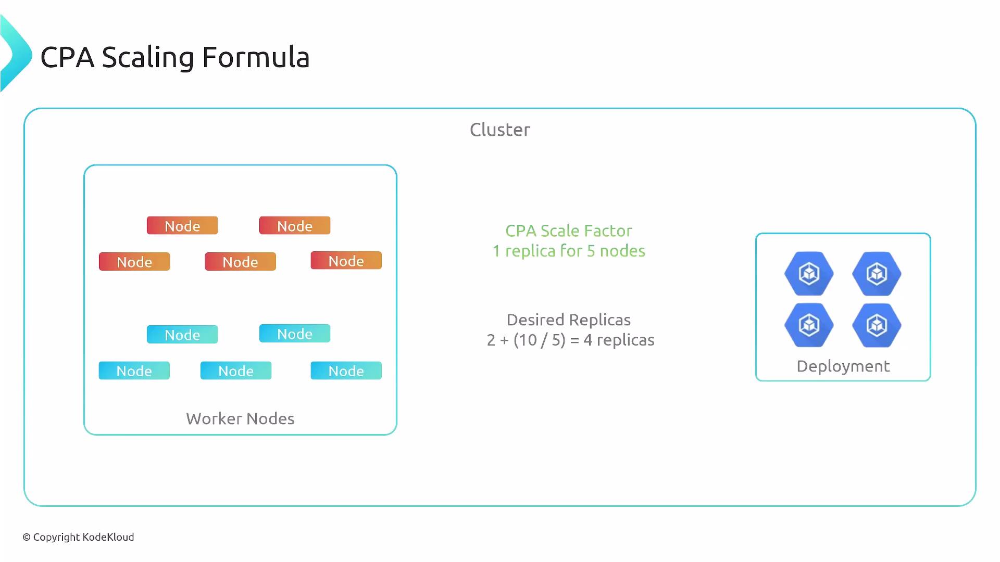
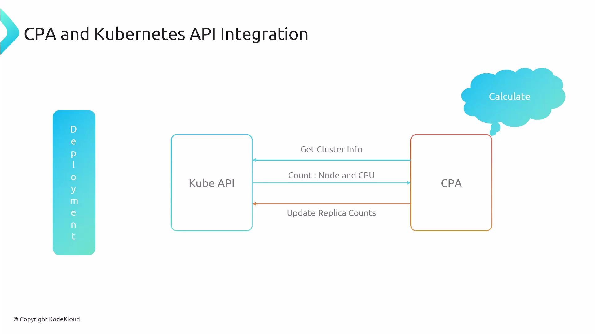

Welcome back. This lesson explains the Cluster Proportional Autoscaler (CPA): what it is, how it decides replica counts, and how to configure its two primary scaling modes - ladder (ступенчатый) and linear (линейный).

CPA automatically adjusts the replica counts of cluster-level Deployments (DNS, network controllers, metrics servers, etc.) based on cluster size or capacity. Think of your Kubernetes cluster as an event venue (площадка для проведения мероприятий/событий): when attendance (посещаемость) increases you add staff (количество персонала) and services (объем услуг); when it decreases, you scale them back. CPA plays the role of an event manager that watches cluster metrics and scales supporting services proportionally.

### How CPA decides replica counts

- CPA reads cluster metrics (node count and/or CPU cores) and respects (учитывает, соблюдает) the `includeUnschedulableNodes` setting when configured.
- It computes desired replicas using either:
  - a ladder (step) mapping (отображение, соответствие) - discrete thresholds (на основе дискретных пороговых значений), or
  - a linear formula - proportional calculation (на основе пропорционального расчета).
- CPA then updates the target Deployment's `spec.replicas` through the Kubernetes API.

Basic conceptual (концептуальная) formula:

```python
desired_replicas = base_replicas + (cluster_metric * scale_factor)
```

Example:

- base_replicas = 2
- scale factor = 1 replica per 5 nodes
- 10-node cluster => desired_replicas = 2 + (10 / 5) * 1 = 4

<br>

### Integration with the Kubernetes API

- CPA queries the kube-apiserver for cluster information (nodes and CPU capacity) and for the Deployments it manages.
- It calculates the desired replica count according to configuration.
- CPA then issues a patch/update to the Deployment `spec.replicas` field via the API.

<br>

### Scaling modes: ladder vs linear

Use the mode that fits (соответствует, подходит) your service characteristics:

- **Ladder mode** - predictable, discrete steps. Good for strict SLAs or when you want controlled change points.
- **Linear mode** - continuous, proportional scaling. Good for smoother (более плавного) scaling based on capacity.

#### Comparison summary:

| Mode | Behavior | When to use |
| ---- | -------- | ----------- |
| Ladder | Discrete thresholds mapping cluster size to fixed replicas | Predictable changes, SLA-sensitive services |
| Linear | Proportional calculation (replicas per node/core), min/max bounds | Smooth scaling with capacity-based distribution |

### Ladder mode

Ladder mode maps ranges of cluster metric values (nodes or cores) to a specific replica count. The mapping is usually stored as a JSON string under a ConfigMap key named `ladder`.

Empty ladder template:

```yaml
data:
  ladder: |-
    {
      "coresToReplicas":
      [
      ],
      "nodesToReplicas":
      [
      ],
      "includeUnschedulableNodes": false
    }
```

Example ladder mappings:

```yaml
data:
  ladder: |-
    {
      "coresToReplicas":
      [
        [1, 1],
        [64, 3],
        [512, 5]
      ],
      "nodesToReplicas":
      [
        [1, 1],
        [2, 2]
      ],
      "includeUnschedulableNodes": false
    }
```

How ladder evaluation works:

- For each mapping (cores or nodes), CPA selects the largest threshold that is less than or equal to the current metric.
  - Example: a cluster with 400 cores will match the `64` threshold (since 400 >= 64 but < 512), yielding 3 replicas from `coresToReplicas`.
- The final replica count depends on how CPA is configured to combine the cores and nodes results (for many setups you will select the mapping for the metric you care about (о которой вы заботитесь) or merge (объединить) results according to the operator's logic).

## Linear mode (тут)

Linear mode computes replica counts using a proportional formula and then applies min/max bounds and protections like `preventSinglePointFailure`.

Linear configuration example (stored as JSON in a ConfigMap key called `linear`):

```yaml
data:
  linear: |-
    {
      "coresPerReplica": 2,
      "nodesPerReplica": 1,
      "min": 1,
      "max": 100,
      "preventSinglePointFailure": true,
      "includeUnschedulableNodes": true
    }
```

Linear calculation rules:

* Compute:
  * `replicas_from_cores = ceil(total_cores / coresPerReplica)`
  * `replicas_from_nodes = ceil(total_nodes / nodesPerReplica)`
* CPA uses the larger of the two values, then enforces `min` and `max`.
* Always round up (ceiling) to prevent under-provisioning.

Example calculation:

* Cluster: 4 nodes, 13 cores
* `coresPerReplica = 2` -> `replicas_from_cores = ceil(13 / 2) = 7`
* `nodesPerReplica = 1` -> `replicas_from_nodes = ceil(4 / 1) = 4`
* Choose the higher value: `7`
* Apply bounds (min=1, max=100): final replicas = `7`

## Best practices and tips

* For critical cluster services (DNS, controllers), set a conservative `min` and consider `preventSinglePointFailure: true`.
* If you need predictable capacity steps for SLA reasons, use ladder mode with deliberate thresholds.
* For smoother autoscaling reacting to cluster capacity, use linear mode and tune `coresPerReplica` and `nodesPerReplica`.
* Consider `includeUnschedulableNodes` only if your cluster topology requires counting nodes that are cordoned/unschedulable.

When configuring CPA, decide whether your service benefits from predictable step-changes (ladder) or proportional scaling (linear). For critical infrastructure (DNS, network controllers) prefer conservative settings and min replicas to avoid single points of failure.

## Summary

* CPA adjusts Deployment replicas for cluster-level services based on node count and/or CPU cores.
* Ladder mode provides discrete, threshold-based scaling; linear mode provides proportional scaling with min/max and redundancy protections.
* CPA integrates with the kube-apiserver to read cluster state and to update Deployment replica counts.
* Choose the mode and configuration that best match your reliability and capacity requirements.

## Links and references

* [Kubernetes Concepts: Scaling](https://kubernetes.io/docs/concepts/cluster-administration/manage-deployment/)
* [Kubernetes API Overview](https://kubernetes.io/docs/reference/using-api/api-overview/)
* For CPA operator specifics, consult your distribution/operator documentation and ConfigMap examples for `ladder` and `linear`.

> [card] [Watch Video](https://learn.kodekloud.com/user/courses/kubernetes-autoscaling/module/ad35ef0b-c572-4f9e-82e4-0865c98fd502/lesson/fffc1694-28ec-4983-a9fe-b573f278a628)


This documentation is built and hosted on [Mintlify](https://mintlify.com), a developer documentation platform.