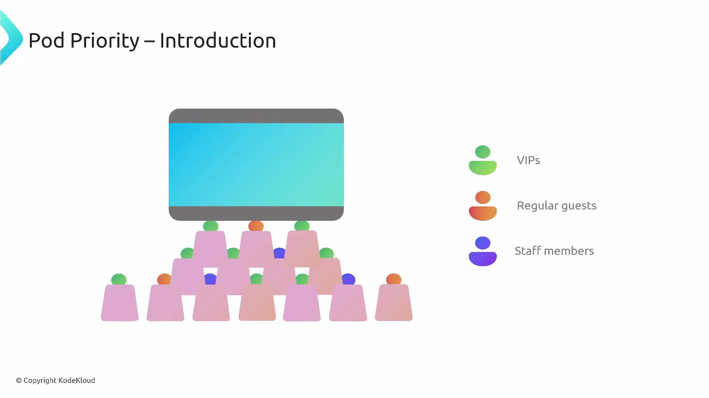
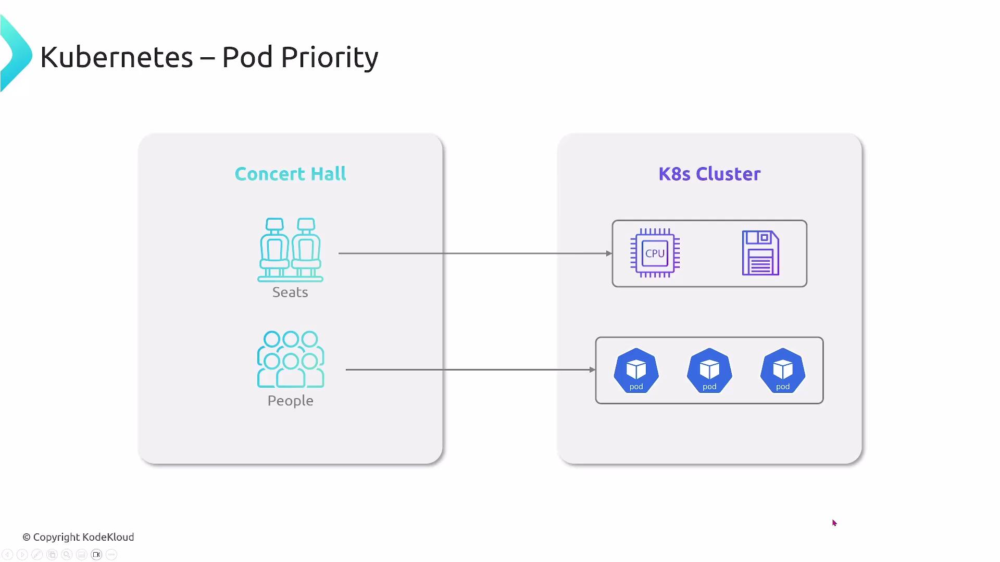
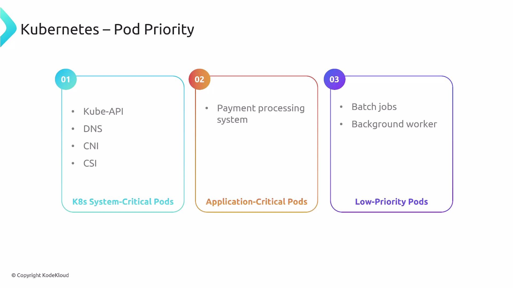
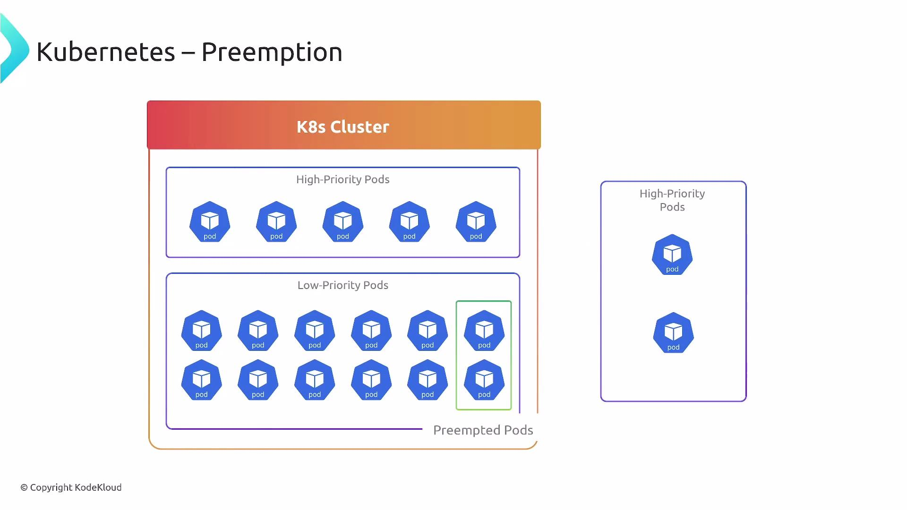
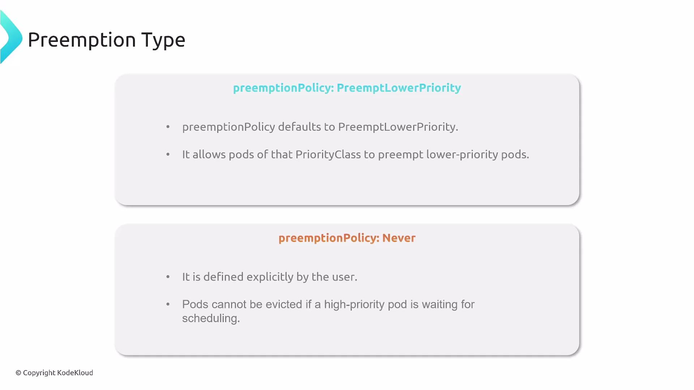
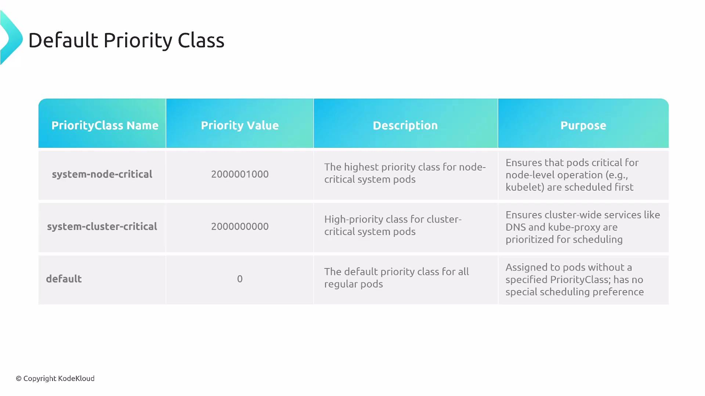

Welcome - this lesson explains Pod Priority and Preemption (превентивные меры) in Kubernetes: how the scheduler decides which workloads get cluster resources when capacity is limited, and how you can control that behavior using PriorityClass and `preemptionPolicy`.

Pod Priority and Preemption (вытеснение) are scheduler features that help guarantee critical system components and high-value applications get scheduled and remain running when the cluster is under resource pressure. We'll use a concert-hall (концертным залом) analogy to make the ideas easier to visualize.

Imagine a large concert hall where seats (мест) are limited. VIPs, regular guests (обычные/постоянные гости), and staff all arrive over time (постепенно, с течением времени). Without a clear priority system, staff and VIPs might not get seats, and the event could fail. In Kubernetes, seats are cluster resources (CPU, memory, etc.), and people are Pods; Priority and Preemption ensure important Pods get the resources they need.

<br>

In Kubernetes terms:

- Seats = available cluster capacity (CPU, memory, ephemeral storage)
- People = Pods (workloads)
- Priority = how important a Pod is relative to others
- Preemption = evicting lower-priority Pods so higher-priority Pods can be scheduled

<br>

Many clusters run low-priority workloads (batch jobs, dev/test workloads, CI runners). If the cluster fills up, these low-priority Pods can block scheduling of more important Pods. Preemption lets the scheduler evict those lower-priority Pods to free resources for higher-priority Pods.

<br>

Preemption is like asking a regular guest to vacate (освободить) their seat so a VIP or staff member can sit. Kubernetes may evict lower-priority Pods to create space for higher-priority Pods when scheduling fails due to resource constraints.

<br>

#### `preemptionPolicy` options

- Pods can control whether they may preempt (вытеснять, предупредить) lower-priority Pods via the `preemptionPolicy` field in the Pod spec.
- Two allowed values:

  | preemptionPolicy | Behavior | Use case |
  | ---------------- | -------- | -------- |
  | `PreemptLowerPriority` | (Default) This Pod may cause eviction of lower-priority Pods to be scheduled. | Use for workloads that must be scheduled even under pressure. |
  | `Never` | This Pod will not preempt lower-priority Pods; it will not evict others to make room (освободить место). | Use for pods that must not evict others (but note: they can still be evicted by higher-priority Pods). |

<br>

Preemption is enabled by default in Kubernetes. Use `preemptionPolicy: Never` only when you must ensure this Pod does not preempt other pods; it does not protect the Pod from being evicted by higher-priority pods.

### How priorities are defined

- Kubernetes uses the PriorityClass resource to assign numeric priorities to pods.
- Higher numeric `value` = higher priority.
- Assign a PriorityClass by setting `priorityClassName` on the Pod (or Pod template inside a Deployment/StatefulSet/DaemonSet).

Example PriorityClass manifests:

```yaml
apiVersion: scheduling.k8s.io/v1
kind: PriorityClass
metadata:
  name: high-priority
value: 1000
globalDefault: false
description: "This priority class is for critical pods."
```

```yaml
apiVersion: scheduling.k8s.io/v1
kind: PriorityClass
metadata:
  name: low-priority
value: 500
globalDefault: false
description: "This priority class is for less critical pods."
```

### Assigning priority to Pods and Deployments

Pod example:

```yaml
apiVersion: v1
kind: Pod
metadata:
  name: high-priority-pod
spec:
  priorityClassName: high-priority
  containers:
  - name: nginx
    image: nginx:stable
```

Deployment example (priority applied to Pods created by the Deployment):

```yaml
apiVersion: apps/v1
kind: Deployment
metadata:
  name: high-priority-deployment
spec:
  replicas: 2
  selector:
    matchLabels:
      app: nginx
  template:
    metadata:
      labels:
        app: nginx
    spec:
      priorityClassName: high-priority
      containers:
      - name: nginx
        image: nginx:stable
```

Kubernetes also includes several built-in PriorityClasses for system-critical components. These built-ins use very large numeric values so system pods outrank (превосходить) user pods.

<br>

#### Quick reference table - typical priority classes

| PriorityClass name | Typical value | Purpose |
| ------------------ | ------------- | ------- |
| `system-node-critical` | `2000001000` | Node/system-critical components (reserved) |
| `system-cluster-critical` | `2000000000` | Cluster-critical system components |
| `default` | `0` | Default for user pods when no PriorityClass is set |

### Control preemption per-Pod

- To prevent a Pod from preempting lower-priority Pods, set `preemptionPolicy: Never` in the Pod spec.
- That does not prevent the Pod itself from being evicted by a higher-priority Pod.

Example: a low-priority Pod that will not preempt others:

```yaml
apiVersion: v1
kind: Pod
metadata:
  name: non-preemptible-pod
spec:
  priorityClassName: low-priority    # Using a low-priority class
  preemptionPolicy: Never            # This pod will not preempt lower-priority pods
  containers:
  - name: non-preemptible-container
    image: nginx:stable
```

### Best practices and operational guidance

- Use PriorityClasses deliberately (осмотрительно). Over-assigning (чрезмерное назначение) high priority reduces scheduler flexibility.
- Reserve the highest numeric values for critical system components.
- Use `preemptionPolicy: Never` sparingly (осмотрительно, экономно) and only when necessary.
- Test preemption behavior in staging before applying critical PriorityClasses in production.
- Combine Priority/Preemption with resource requests/limits and PodDisruptionBudgets (PDBs) for predictable scheduling and resilience.

**PodDisruptionBudget (PDB)** - это объект политики в Kubernetes, который ограничивает, сколько подов из группы может быть одновременно недоступно во время плановых работ. Его задача - не дать кластеру "выселить" слишком много экземпляров приложения за один раз, чтобы сервис продолжал работать.

### Summary

- Pod Priority ensures critical workloads are preferred by the scheduler when resources are scarce (скудные, недостаточные).
- Preemption frees resources for higher-priority Pods by evicting lower-priority Pods when necessary.
- Priority is defined with PriorityClass resources and assigned via `priorityClassName` in Pod specs.
- Use `preemptionPolicy` to control whether a Pod may evict lower-priority Pods.