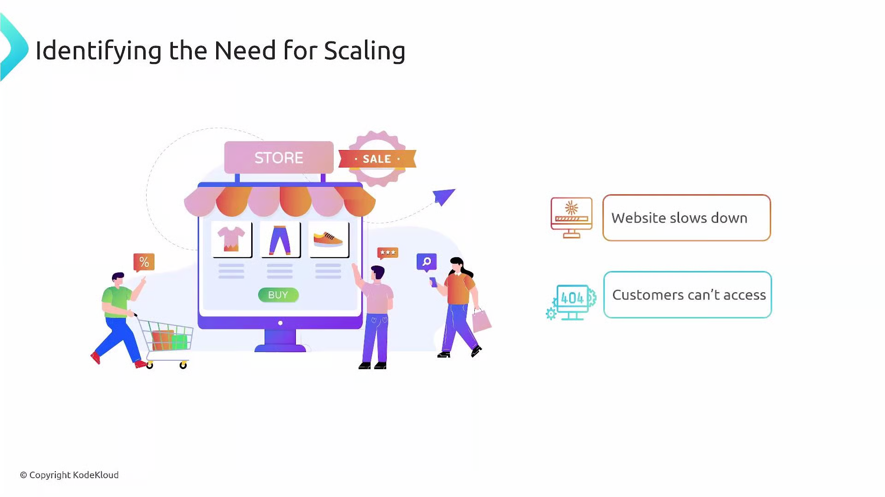
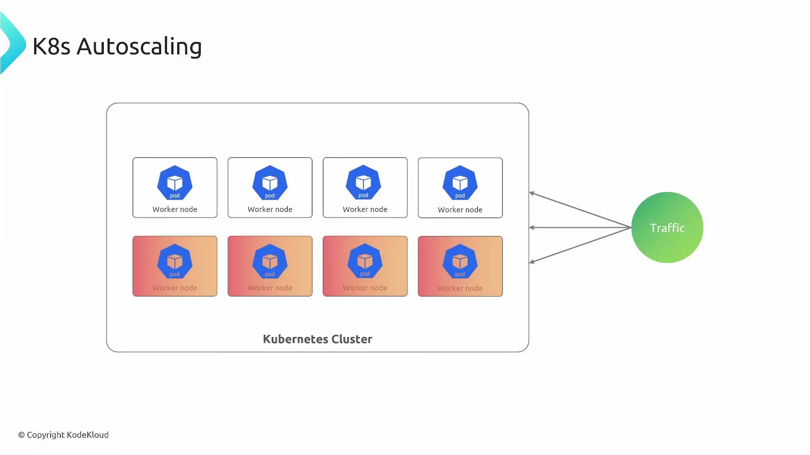
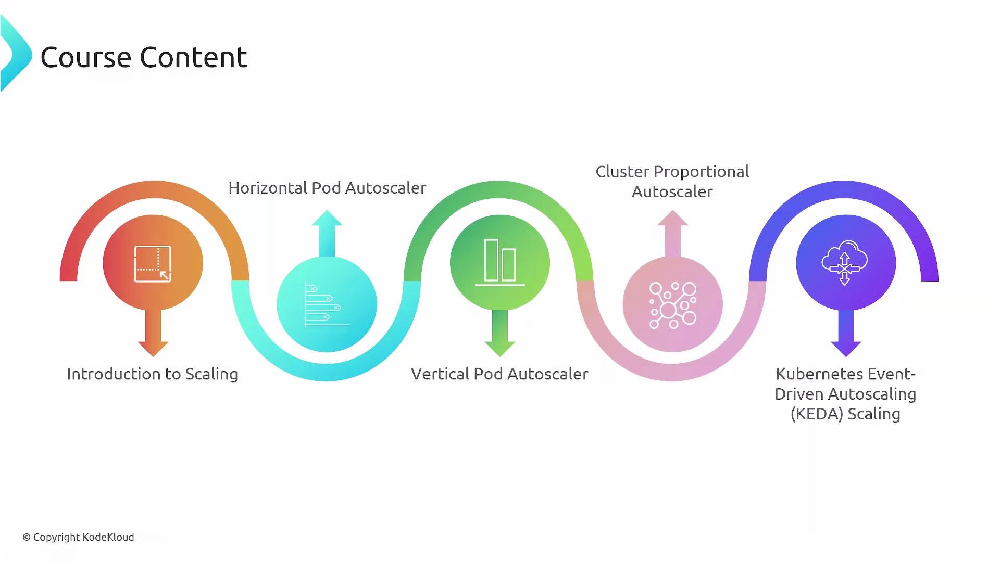

Welcome.

This lesson covers Kubernetes autoscaling - how to automatically adjust (регулировать) application and cluster capacity (вместимость, мощность, пропускная способность) so your workloads remain resilient (устойчивыми) and responsive as traffic changes. You'll learn when to scale, which autoscaler to use, and practical patterns to avoid common pitfalls (подводные камни).

Imagine you run an online store and traffic spikes (резко подскочить) during a flash sale (распродажа). If capacity doesn't increase quickly enough (достаточно быстро), pages slow or become unavailable and users abandon (бросать) their carts (корзины). Autoscaling prevents that by increasing resources when demand (спрос) rises (повышается) and decreasing them when demand falls, keeping costs (расходы) under control while preserving (сохраняя) performance (производительность).

 

Autoscaling behaves like a thermostat for your infrastructure: it observes (наблюдает) load (metrics or events) and adjusts capacity so applications meet their service levels. In Kubernetes this can mean scaling application replica counts, resizing container resource requests/limits, or adding and removing nodes.

At a high level:

- Your applications run inside Pods on worker nodes.
- The control plane schedules Pods onto nodes.
- When load increases, you may need more Pod replicas and/or more nodes to host them.
- Different autoscalers handle these responsibilities (обязанности): some scale Pods, others right-size (оптимизировать, подобрать подходящий размер) resources, and others manage the underlying node pool.

 

What we'll cover in this course

- Definitions (определения) and scaling (масштабирования) goals (цели): when to scale horizontally vs vertically, and how to measure success.
- Horizontal Pod Autoscaler (HPA): scale replicas using CPU, memory, custom, or external metrics.
- Vertical Pod Autoscaler (VPA): recommend or apply container resource requests/limits to right-size Pods.
- Cluster Proportional (пропорциональный) Autoscaler (CPA): scale cluster-level or add-on replicas proportionally to node count (масштабирование реплик компонентов уровня кластера или дополнений пропорционально количеству узлов).
- Cluster Autoscaler (and alternatives like Karpenter): add/remove nodes based on pending Pods and scheduling constraints.
- KEDA (Kubernetes Event-Driven Autoscaler): scale based on event sources (message queues, streams) and enable scale-to-zero (масштабирование до нуля) patterns.
- Hands-on (практические) examples and recommended patterns to avoid conflicts and instability (нестабильности).

 

Autoscaler summary

| Autoscaler | What it changes | Typical use case | Docs / Notes |
| ---------- | --------------- | ---------------- | ------------ |
| Horizontal Pod Autoscaler (HPA) | Replica count of Deployments/ReplicaSets/StatefulSets | Scale application instances based on metrics (CPU/memory/custom/external) | [HPA docs](https://kubernetes.io/docs/tasks/run-application/horizontal-pod-autoscale/) |
| Vertical Pod Autoscaler (VPA) | Container resource requests/limits | Right-size container resources for stable workloads (not for sudden replica bursts) | [VPA overview](https://github.com/kubernetes/autoscaler/tree/master/vertical-pod-autoscaler) |
| Cluster Proportional Autoscaler (CPA) | Replica counts for cluster-level add-ons | Scale DNS, monitoring, or other control-plane add-ons relative to node count | Useful for system components |
| Cluster Autoscaler | Node pool size (add/remove nodes) | Ensure pending Pods can be scheduled by adjusting node count | [Cluster Autoscaler](https://cluster-autoscaler.kubernetes.io/) |
| KEDA | Triggers for scaling (integrates with HPA or ScaledObjects) | Event-driven scaling based on queue/message lengths or custom event sources | [KEDA](https://keda.sh/) |

- sudden - неожиданный
- burst - взрыв

A few clarifying (уточняющих) points (моментов)

- HPA adjusts the number of Pod replicas for Deployments, ReplicaSets, and StatefulSets and supports built-in (CPU/memory), custom, and external metrics.
- VPA adjusts container resource requests and/or limits to right-size Pods. VPA does not increase replica counts - use HPA for replica-based scale-out.
- CPA targets cluster-level services and scales their replicas relative to node count (helpful for DNS, logging, and monitoring add-ons).
- Cluster Autoscaler (and alternatives like Karpenter on AWS) changes node count based on unschedulable Pods and cloud-provider scaling policies.
- KEDA connects to external event sources (Kafka, SQS, Azure Queue, Prometheus, etc.) and exposes metrics or triggers (триггеры) that drive scaling (управляющие масштабированием), including scale-to-zero.

**Avoid uncontrolled interaction between HPA and VPA: if both modify the same resource targets (for example, container CPU requests), they can create oscillations (колебаний). Use recommended patterns - like VPA in "recommend" mode with HPA controlling replica count - or split responsibilities (ответственности) by workload type.**
(here)
We'll include hands-on examples for manual and automated scaling, plus practical tips to avoid common issues (metric selection, cooldowns, target utilization, and resource fragmentation). Follow along to learn when to use HPA, VPA, CPA, Cluster Autoscaler, and KEDA so your applications remain available during spikes and efficient during low load.

<Callout icon="lightbulb" color="#1CB2FE">
  By the end of this course you'll understand how these autoscalers interact, which to use for different problems, and implementation best practices so applications stay available under changing load.
</Callout>

Links and references

* [Kubernetes Documentation](https://kubernetes.io/docs/)
* [Cluster Autoscaler](https://cluster-autoscaler.kubernetes.io/)
* [Karpenter (AWS alternative)](https://karpenter.sh/)
* [KEDA - Event-Driven Autoscaling](https://keda.sh/)
* [Vertical Pod Autoscaler (VPA) repo](https://github.com/kubernetes/autoscaler/tree/master/vertical-pod-autoscaler)

Ready to get started with the first hands-on lesson?

<CardGroup>
  <Card title="Watch Video" icon="video" cta="Learn more" href="https://learn.kodekloud.com/user/courses/kubernetes-autoscaling/module/66710f67-c094-4a4c-b718-4a031d1ddebe/lesson/7605b2e1-8fbb-4b8c-849e-8f6a8c02f064" />
</CardGroup>

This documentation is built and hosted on [Mintlify](https://mintlify.com), a developer documentation platform.