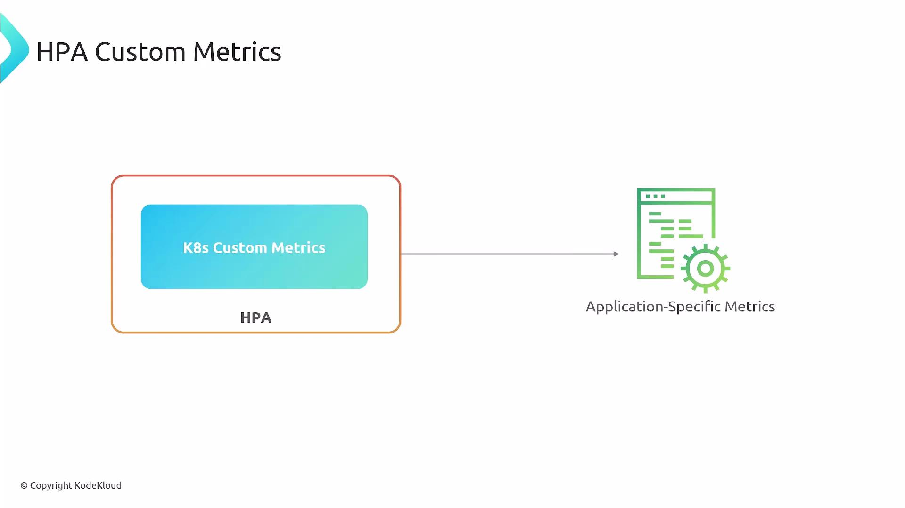
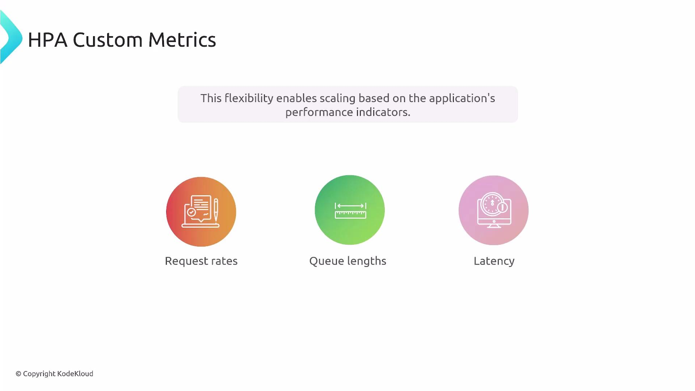
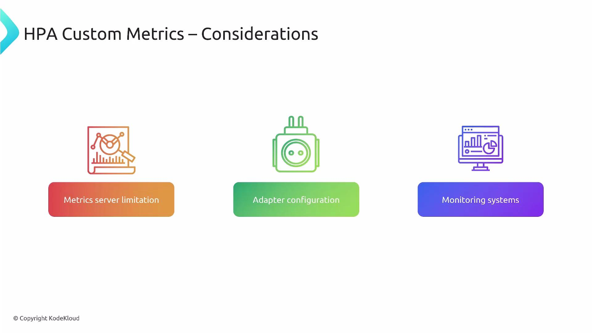

This lesson explains how to use custom metrics with the Kubernetes Horizontal Pod Autoscaler (HPA) and the components that enable application-specific metrics to drive scaling decisions. While built-in resource metrics (CPU, memory) are common (чаще всего используются), custom metrics let you autoscale based on business- or performance-oriented signals such as request rate, queue depth, or latency.

<br>

Why use custom metrics?

- They reflect application behavior and user experience more directly (более точно) than CPU/memory.
- They let you scale on real business signals (e.g., requests/sec, queue length, latency).
- They enable smarter (более продуманное) autoscaling rules that can reduce cost while maintaining (поддерживая, сохраняя) performance.

<br>

How custom metrics reach the HPA (the relay - эстафета, передача)

Custom metrics require a small pipeline (конвейер) inside the cluster. Think of this as a relay (эстафета) with four main runners (бегунами):

1. Application instrumentation - your app exposes metrics (libraries like Prometheus client libraries or OpenTelemetry).
2. Metrics collection - a monitoring system scrapes or receives those metrics (for example, Prometheus server).
3. Metrics adapter - translates the monitoring system's metrics into the Kubernetes Metrics API (exposes `custom.metrics.k8s.io` or `external.metrics.k8s.io`).
4. HPA - queries the Kubernetes API to read those metrics and scales Deployments/ReplicaSets accordingly.

Table: Components and responsibilities

| Component | Responsibility | Example |
| --------- | -------------- | ------- |
| Application | Expose application-specific metrics | Use Prometheus client libraries or OpenTelemetry |
| Collector | Scrape/receive and store metrics | Prometheus server |
| Adapter | Map collector metrics to Kubernetes metric APIs | `prometheus-adapter` (exposes `custom.metrics.k8s.io`) |
| HPA | Query metrics via Kubernetes API and scale resources | HorizontalPodAutoscaler (autoscaling/v2) |

Concretely (конкретнее), an adapter implements one or more of the metric APIs the HPA understands (for example, `custom.metrics.k8s.io` or `external.metrics.k8s.io`), mapping monitoring-system metrics into those APIs. A common setup is Prometheus + [prometheus-adapter](https://github.com/kubernetes-sigs/prometheus-adapter).

Kubernetes' built-in Metrics Server only provides resource metrics (`metrics.k8s.io`) for CPU and memory. To use application-level custom metrics you must run a monitoring system and an adapter (for example, Prometheus + `prometheus-adapter`) that exposes the metrics through the Kubernetes Custom/External Metrics APIs. See the Kubernetes core metrics pipeline docs for details:

https://kubernetes.io/docs/tasks/debug-application-cluster/core-metrics-pipeline/#metrics-server

<br>

Practical considerations when using custom metrics

- Metrics server limitation: The default `metrics-server` serves only resource metrics. Install a monitoring stack (e.g., Prometheus) for application metrics.
- Adapter configuration: Install an adapter that implements the Custom/External Metrics APIs and map monitoring metrics to API resources. Configure metric names, namespaces, and RBAC carefully.
- Monitoring instrumenting: Make sure application agents, exporters, or client libraries expose metrics in a scrapeable/receivable format.
- Latency and staleness (застой, несвежесть): Monitor scrape intervals, adapter refresh rates, and HPA stabilization windows to avoid scaling on stale (устаревшими) or bursty (взрывной, неравномерный) data.
- Naming consistency (согласованность): Use consistent  metric names and labels between application code, monitoring system, and adapter rules.

API surface (поверхность, интерфейс) and metric types

| Metric API | Purpose | Notes |
| ---------- | ------- | ----- |
| `metrics.k8s.io` | Resource metrics (CPU/memory) | Provided by Metrics Server |
| `custom.metrics.k8s.io` | Per-object or per-pod application metrics | For metrics exposed per Kubernetes object or pod |
| `external.metrics.k8s.io` | Metrics not tied to Kubernetes objects | For external systems e.g., cloud provider metrics or external queue depth |

Example: minimal HPA using a per-Pod custom metric

This sample HPA scales a Deployment named `my-app` using a per-pod custom metric called `requests_per_second`. The adapter must expose `requests_per_second` via the Custom Metrics API.

```yaml
apiVersion: autoscaling/v2
kind: HorizontalPodAutoscaler
metadata:
  name: my-app-hpa
spec:
  scaleTargetRef:
    apiVersion: apps/v1
    kind: Deployment
    name: my-app
  minReplicas: 1
  maxReplicas: 10
  metrics:
    - type: Pods
      pods:
        metric:
          name: requests_per_second
        target:
          type: AverageValue
          averageValue: "10"
```

Verify that the adapter exposes metrics

- Query the custom metrics API (example):

```bash
$ kubectl get --raw "/apis/custom.metrics.k8s.io/v1beta1/"
```

- Check the adapter's diagnostics or metrics endpoint (adapter-specific).

Notes and best practices

- Consistent naming: Keep metric names and labels aligned across application, collector, and adapter configuration.
- Validate exposure: Use `kubectl get --raw` to confirm the metric is available under the expected API path.
- Monitor pipeline latency: Scrape intervals and adapter refresh frequencies affect scaling reaction time.
- Stabilize scaling: Use HPA stabilization windows and threshold tuning (настройку пороговых значений) to reduce flapping (колебания, взмахивания) from transient (временных) spikes (пиков).
- RBAC and security: Ensure the adapter has proper permissions to expose metrics and that the HPA can query them.

Summary

Custom metrics enable HPA to scale workloads based on application-specific signals rather than only CPU/memory. To use them effectively you need:

- Application instrumentation (Prometheus/OpenTelemetry)
- A metrics collector (e.g., Prometheus)
- An adapter that exposes metrics through `custom.metrics.k8s.io` or `external.metrics.k8s.io`
- A configured HPA that references those metrics

When properly configured, this pipeline enables meaningful (значимое), business-focused autoscaling that optimizes performance and cost.