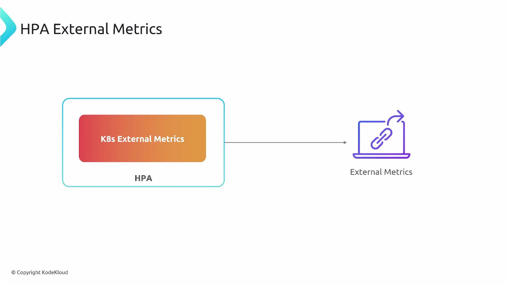
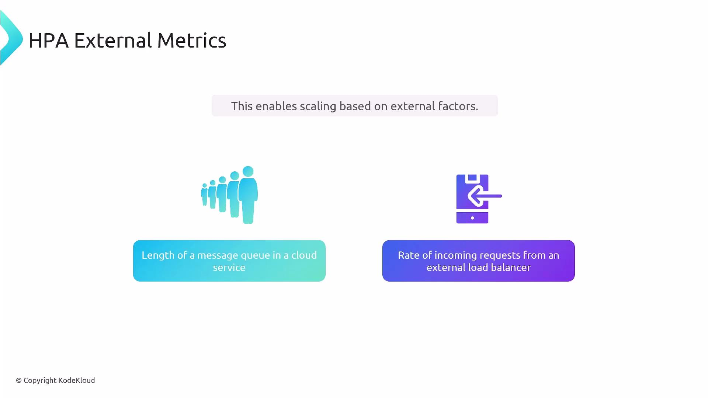
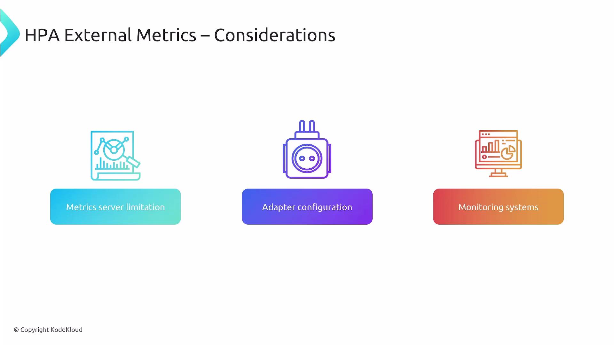

Welcome. This guide explains how Kubernetes external metrics work with the Horizontal Pod Autoscaler (HPA), why they matter, and how to put them into production.

External metrics differ from native resource metrics (CPU/memory) and application-level custom metrics. They originate outside the cluster (or outside the pod resource model) and are made available (становятся доступными для) to the HPA so scaling decisions can be based on external systems and services.

<br>

### Why use external metrics?

- Scale based on external systems such as cloud-managed queues, third-party APIs, or external load balancers.
- Make proactive scaling decisions from signals that don't exist inside pod metrics (for example, queue backlog (накопившиеся в очереди задачи) or external request rate).
- Integrate infrastructure- or business-level signals (billing events, backlog thresholds, SaaS metrics) into Kubernetes autoscaling.

Common examples:

- A cloud-based message queue backlog drives additional consumers.
- An external load balancer's observed request rate determines replica count.

<br>

### Architecture and data flow

External metrics rely on a small set of components working together:

- External metric source: the cloud provider, message queue, or third-party service exposing the metric.
- Collection/monitoring system: gathers metrics from the external source (examples: Prometheus, cloud monitoring like Cloud Monitoring / CloudWatch).
- Metrics adapter: translates collected metrics into the Kubernetes External Metrics API so the HPA can query them.
- HPA: requests metrics via the Kubernetes API and uses the returned values to scale workloads.

Think: the monitoring system is the scout (разведчик) that fetches (собирает) values, and the adapter is the translator exposing them to Kubernetes.

### Components summary

| Component | Purpose | Example |
| --------- | ------- | ------- |
| External metric source | Origin of the metric (outside the cluster) | Cloud queue backlog, external LB request rate |
| Collector / monitoring | Pulls or receives external metrics | [Prometheus](https://prometheus.io/), Cloud Monitoring / CloudWatch |
| Metrics adapter | Implements Kubernetes External Metrics API and bridges collector => K8s API | `prometheus-adapter`, cloud provider adapters |
| HPA | Queries the External Metrics API and makes scaling decisions | `HorizontalPodAutoscaler` (autoscaling/v2) |

The default Kubernetes Metrics Server only serves resource metrics (CPU/memory) and does not expose external metrics. Deploy a metrics adapter that implements the External Metrics API (for example, the [Prometheus Adapter](https://github.com/kubernetes-sigs/prometheus-adapter) or a cloud-specific adapter) to allow the HPA to consume external signals.

### Important considerations

- You need a reliable collector/monitoring layer that can fetch external values (via scraping, API polling, or event ingestion).
- An in-cluster metrics adapter must be configured to expose metrics through the Kubernetes External Metrics API.
- The adapter must support querying metrics by name and labels so the HPA can target the correct time series.
- Validate auth, network connectivity, and metric naming between source => collector => adapter => HPA.

<br>

### Practical configuration tips

- Choose a monitoring backend that reliably collects your external signal (queue depth, request rate, third-party metric).
- Select an adapter compatible with your metric store (for Prometheus, use the Prometheus Adapter; for cloud metrics, use the cloud provider's adapter).
- In the HPA spec, reference the external metric by name and supply label selectors if required to match the right series.
- Test the full pipeline (external source => collector => adapter => Kubernetes API => HPA) and validate both metric accuracy (точность) and timeliness (своевременность).

#### Example: HPA referencing an external metric (autoscaling/v2)

```yaml
apiVersion: autoscaling/v2
kind: HorizontalPodAutoscaler
metadata:
  name: example-external-hpa
spec:
  scaleTargetRef:
    apiVersion: apps/v1
    kind: Deployment
    name: my-app
  minReplicas: 1
  maxReplicas: 10
  metrics:
    - type: External
      external:
        metric:
          name: queue_messages_ready
          selector:
            matchLabels:
              queue: orders
        target:
          type: Value
          value: "100"
```

### Testing and observability checklist

- Confirm the collector is scraping/pulling the external metric and exposing it in the monitoring backend.
- Verify the adapter reports (предоставляет, передает) the metric through the Kubernetes External Metrics API:
  - `kubectl get --raw "/apis/external.metrics.k8s.io/v1beta1"` (adapter dependent)
- Check HPA events and status:
  - `kubectl describe hpa example-external-hpa`
- Monitor adapter and collector logs/alerts to detect failures or missing series.

If the adapter or collector is misconfigured or unavailable, the HPA will not receive external metrics and scaling may not occur. Continuously monitor adapter health and metric endpoints to avoid gaps in autoscaling.

And that's it (вот и всё) - use external metrics to incorporate (включить) business- and infrastructure-level signals into HPA-driven scaling. Explore adapters that match your monitoring backend and external sources to make autoscaling both reliable (надежным) and proactive (упреждающим).