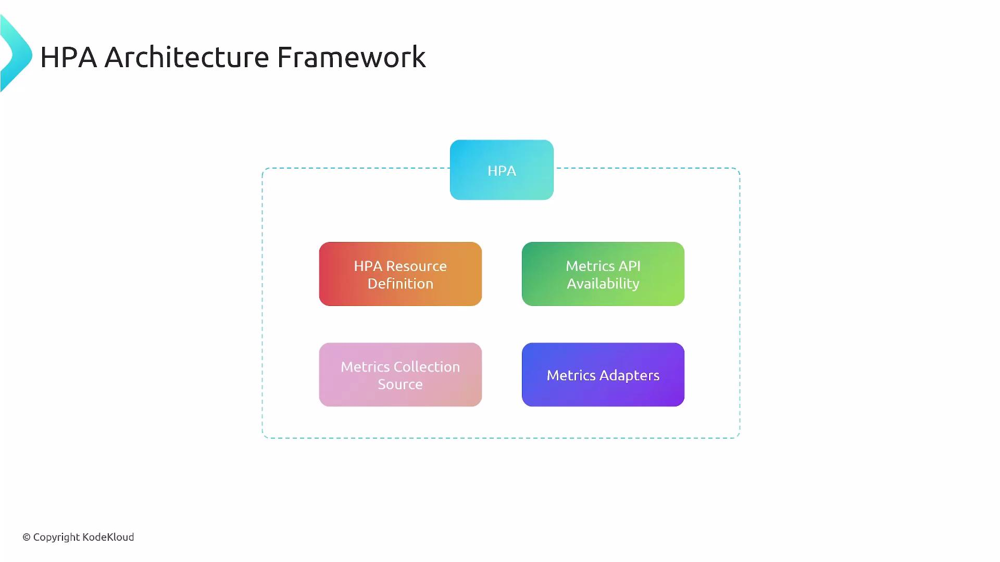
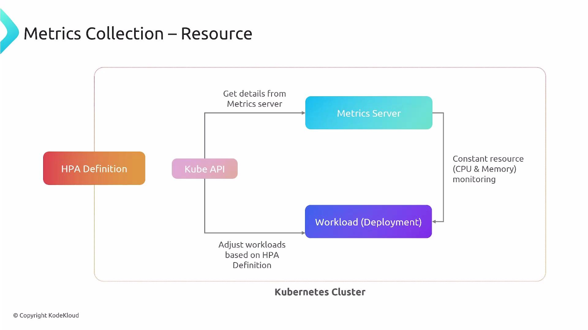
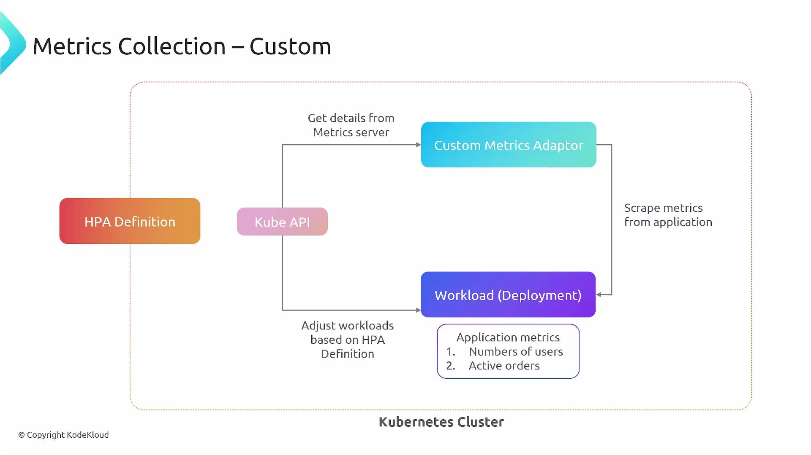
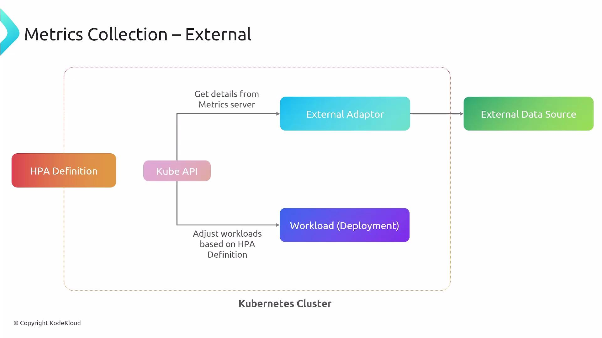
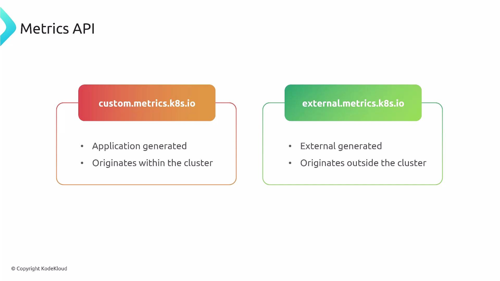
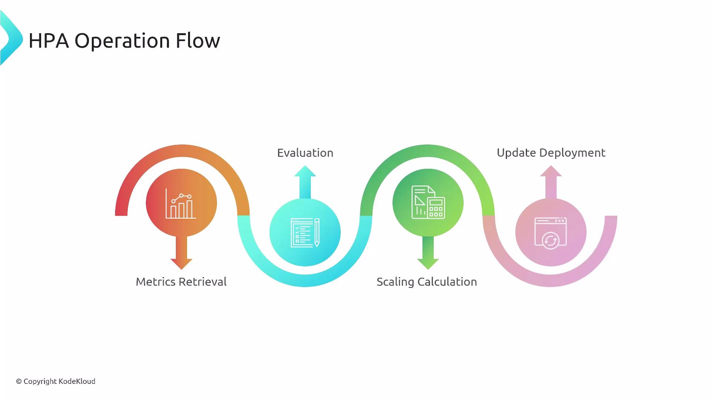
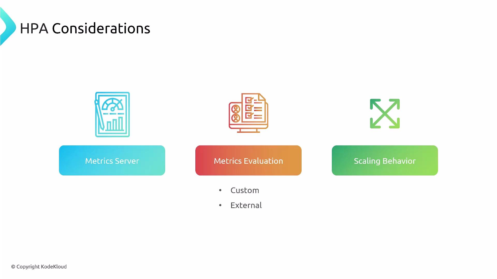

In this lesson we continue exploring the Horizontal Pod Autoscaler (HPA) by breaking down (разобрав) its architecture and the runtime workflow that takes metrics from various sources and turns them into scaling decisions. This guide focuses on how HPA consumes metrics (resource, custom, and external), how adapters expose those metrics to Kubernetes, and how the HPA control loop (цикл управления) reconciles (согласовывает, корректирует) replica counts.

At a high level the HPA:

- Automatically adjusts the number of pod replicas for a target workload (Deployment, StatefulSet, ReplicaSet, etc.).
- Can use resource metrics (CPU/memory), custom in-cluster metrics, or external metrics from third-party monitoring/APM systems.
- Requires metric adapters or a Metrics Server to expose non-native (не встроенные, сторонние) metric sources (источники метрик) through the Kubernetes Metrics APIs.

APM-система (Application Performance Monitoring) - это класс программных решений, предназначенных для отслеживания, анализа и оптимизации работы, скорости и доступности критически важных для бизнеса приложений.

Primary HPA components

- HPA resource definition: YAML manifest that designates (в котором указывается/определяется) the target workload, minimum/maximum replicas, and the metric targets.
- Metrics API availability & collection sources: the Kubernetes metric API endpoints that the HPA controller queries.
- Metrics adapters: bridge (интегрирует) external or custom metric sources into Kubernetes via `custom.metrics.k8s.io` or `external.metrics.k8s.io`.

<br>

HPA resource definition example (CPU utilization)

- This HPA keeps average CPU utilization across pods at 50%, with a minimum of 2 replicas and a maximum of 10.

```yaml
apiVersion: autoscaling/v2
kind: HorizontalPodAutoscaler
metadata:
  name: my-deployment-hpa
  namespace: default
spec:
  scaleTargetRef:
    apiVersion: apps/v1
    kind: Deployment
    name: my-deployment
  minReplicas: 2
  maxReplicas: 10
  metrics:
    - type: Resource
      resource:
        name: cpu
        target:
          type: Utilization
          averageUtilization: 50
```

How metrics flow into (поступают/вливаются в) HPA

- HPA queries the Metrics APIs through the kube-apiserver.
- Metrics may come from the built-in Metrics Server (resource metrics), from in-cluster sources exposed via a custom metrics adapter, or from external systems via an external metrics adapter.
- Adapters translate or proxy metrics so the HPA controller sees them through Kubernetes-standard API groups.

Resource metrics (native)

- The Metrics Server exposes CPU and memory metrics under `metrics.k8s.io`. HPA reads these via the kube-apiserver and uses them for resource-based scaling.

<br>

Custom metrics (in-cluster application metrics)

- Custom metrics are application-generated metrics exposed inside the cluster and surfaced to (поверхность, всплыть, передаются в) Kubernetes via `custom.metrics.k8s.io`.
- A custom metrics adapter scrapes (соскребать, собирать) or fetches (получать) metrics from application endpoints, Prometheus, or other in-cluster sources and exposes them to the custom metrics API.
- HPA can target (ориентироваться на, использовать) these metrics to scale (для масштабирования) based on (на основе) application-specific indicators such as requests per second, queue length, or active users.

Example HPA using a pods-level custom metric `http_requests_per_second`:

- This HPA targets an average of `100` requests per second across pods.

```yaml
apiVersion: autoscaling/v2
kind: HorizontalPodAutoscaler
metadata:
  name: my-app-hpa
  namespace: default
spec:
  scaleTargetRef:
    apiVersion: apps/v1
    kind: Deployment
    name: my-app
  minReplicas: 2
  maxReplicas: 10
  metrics:
    - type: Pods
      pods:
        metric:
          name: http_requests_per_second
        target:
          type: AverageValue
          averageValue: "100"
```

<br>

External metrics (outside the cluster)

- External metrics originate outside (поступают/происходят извне) the Kubernetes cluster (cloud provider metrics, external APMs like New Relic, Datadog, Dynatrace).
- An external metrics adapter runs in-cluster and bridges those external sources into `external.metrics.k8s.io`.
- HPA queries these metrics through the kube-apiserver to make scaling decisions.

Example HPA using an external metric `newrelic.app.response_time`:

- If the external metric value exceeds `500`, the HPA will factor (учтёт) that into scaling behavior.

```yaml
apiVersion: autoscaling/v2
kind: HorizontalPodAutoscaler
metadata:
  name: my-app-hpa
  namespace: default
spec:
  scaleTargetRef:
    apiVersion: apps/v1
    kind: Deployment
    name: my-app
  minReplicas: 2
  maxReplicas: 10
  metrics:
    - type: External
      external:
        metric:
          name: newrelic.app.response_time
        target:
          type: Value
          value: "500"
```

<br>

Metrics API overview

- `metrics.k8s.io` - resource metrics (CPU, memory) from Metrics Server.
- `custom.metrics.k8s.io` - application-generated metrics exposed via a custom metrics adapter.
- `external.metrics.k8s.io` - externally generated metrics surfaced via an external metrics adapter.

| Metrics API | Typical Source | Use Case / Examples |
| ----------- | -------------- | ------------------- |
| `metrics.k8s.io` | Metrics Server | CPU and memory resource metrics for pods/nodes |
| `custom.metrics.k8s.io` | Prometheus, App endpoints (via adapter) | `http_requests_per_second`, queue depth, per-pod custom KPIs |
| `external.metrics.k8s.io` | Cloud provider APIs, APMs (via adapter) | `newrelic.app.response_time`, Datadog metrics, cloud load balancer metrics |

<br>

Adapters and common implementations

- Prometheus Adapter: exposes Prometheus metrics as `custom.metrics.k8s.io` - common for Prometheus-based stacks.
- Cloud/Third-party adapters: Datadog, New Relic, and other providers supply (поставляют) external metric adapters to surface APM data into Kubernetes.

Make sure a Metrics Server (or equivalent) and the required metric adapters are installed and functioning. Without them, HPA cannot retrieve (забрать, извлекать) the metrics it needs to make scaling decisions.

HPA control loop and operation flow

- The HPA controller runs a periodic control loop (sync period configurable via controller manager flags). Each iteration:
  1. Retrieves metrics from the Metrics APIs.
  2. Evaluates current values against configured targets.
  3. Calculates the desired replica count when thresholds are breached (превышено, нарушено).
  4. Updates the target workload (Deployment/StatefulSet) with the new replica count, subject to (с учетом) scale policies.

<br>

Additional considerations and best practices

- Deploying Metrics Server: Some distributions omit (не включают, пропускают) it by default. Confirm `metrics-server` is running and reachable.
- Scaling policy tuning: Use multiple metrics and configure scale-up/scale-down policies and stabilization windows to prevent oscillation (колебания).
- Aggressiveness (агрессивность): Determine how aggressive scaling should be based on your cost, latency and SLA (Service Level Agreement) requirements.
- Testing and observability: Validate HPA behavior with load tests and monitor HPA events (`kubectl describe hpa <name>`) and adapter logs.

<br>