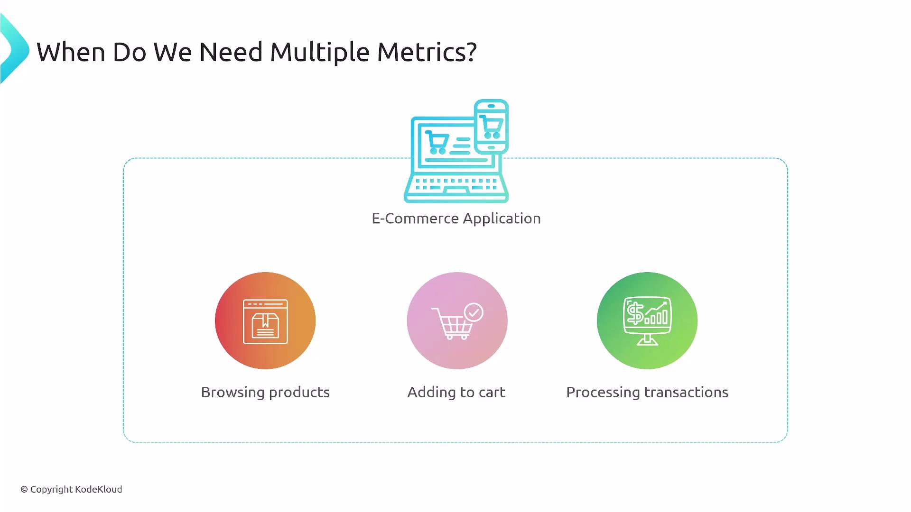
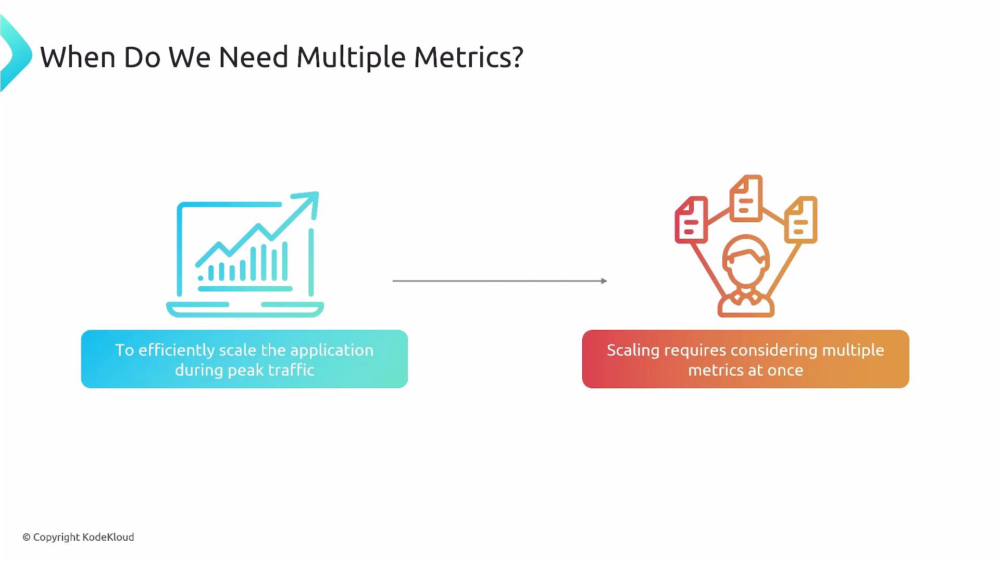
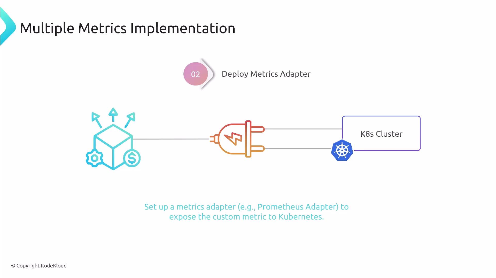
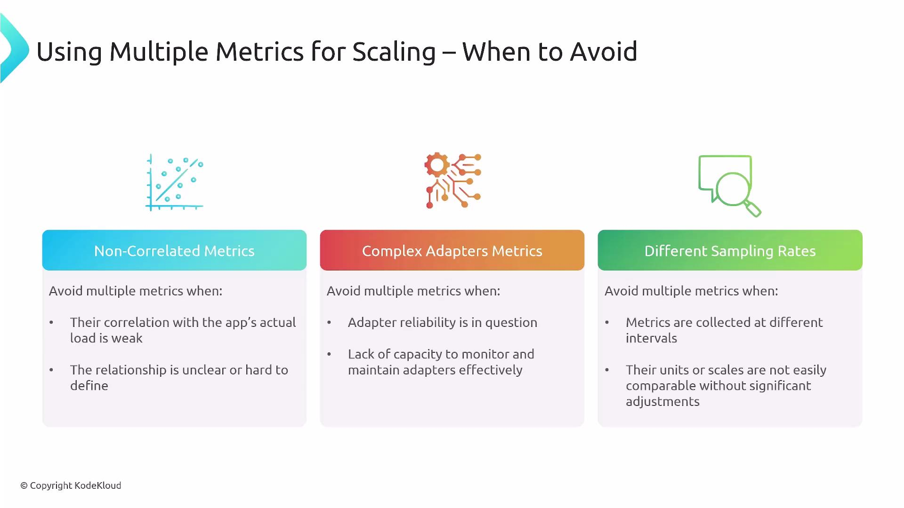

Welcome. In this lesson we'll cover how to use multiple metrics with the Horizontal Pod Autoscaler (HPA) to build more accurate, reliable autoscaling policies.

Why this matters: a complex microservices application (for example, an e‑commerce platform) can show different load characteristics (характеристики) across services. Scaling only by CPU or memory may not reflect actual application load - you may need to combine resource metrics (CPU) with application-level metrics (request rate, active HTTP requests, queue length) to scale the right component at the right time.

<br>

Consider an e‑commerce stack split into microservices: product-catalog, cart (корзина) service, and transaction processor (процессор, обработчик). Each service may require different scaling signals - product-catalog might need CPU plus incoming request rate, while transaction processing (обработка транзакций) may need concurrency (параллельность, количество одновременных операций) or queue length. Multiple metrics let HPA satisfy the strictest (наиболее строгое) requirement across the configured metrics.

<br>

### Architecture and required components

- **Cluster resource metrics**: Ensure a working cluster metrics pipeline (metrics-server) to provide resource metrics like CPU and memory.
- **Application instrumentation**: Expose custom application metrics (e.g., active HTTP requests, requests per second, queue length) via Prometheus or another collector.
- **Metrics adapter**: Deploy an adapter (for example, Prometheus Adapter) to make custom metrics available through the Kubernetes metrics API so HPA can consume them.

<br>

### How HPA evaluates multiple metrics

- HPA reads all configured metrics (resource and external/custom).
- For each metric, HPA computes the desired replica count required to meet that metric's target.
- The HPA then scales to the highest of those desired replica counts so that all targets are satisfied.

#### Example: scale a Deployment named `backend-service` by CPU utilization and a custom per-pod metric `active_http_requests`:

```yaml
apiVersion: autoscaling/v2
kind: HorizontalPodAutoscaler
metadata:
  name: backend-service-hpa
spec:
  scaleTargetRef:
    apiVersion: apps/v1
    kind: Deployment
    name: backend-service
  minReplicas: 2
  maxReplicas: 10
  metrics:
  - type: Resource
    resource:
      name: cpu
      target:
        type: Utilization
        averageUtilization: 70
  - type: Pods
    pods:
      metric:
        name: active_http_requests
      target:
        type: AverageValue
        averageValue: "100"
```

#### Notes about the configuration:

- `averageUtilization: 70` targets ~70% CPU utilization across the pods.
- The `Pods` metric type with `AverageValue` targets an average of `100` `active_http_requests` per pod. The adapter must expose `active_http_requests` as a pods-scoped metric.
- HPA evaluates both metrics and scales to the highest computed replica count.

### Metric types at a glance

| Metric Type | Scope | Best for | Example |
| ----------- | ----- | -------- | ------- |
| Resource | Pod/Container | CPU & memory-driven scaling | `cpu` utilization |
| Pods | Per-pod custom | Metrics that are naturally measured per pod (concurrency, active requests) | `active_http_requests` |
| External | Cluster/external service | Metrics external to pods (queue length in external system, cloud metrics) | `sqs_queue_length` |

### When NOT to use multiple metrics

- Metrics are not correlated to actual service load (e.g., CPU stuck (застревает, остается) at high value with no request changes).
- The metrics adapter or metric source is unreliable (ненадежный) or hard to maintain.
- Metrics have incompatible sampling intervals (интервалы дискретизации/выборки) or units (единицы измерения) (one metric sampled every second vs another every 10 minutes).
- The added complexity of reconciling (согласования) multiple metrics outweighs (перевешивает) autoscaling benefits.

<br>

Ensure your cluster has a working metrics pipeline (`metrics-server`) and a compatible adapter (for example, the Prometheus Adapter) before relying on custom metrics for HPA. Verify sampling intervals, metric names, and scope (pods vs. external) to avoid surprising behavior.

### Best practices

- Start simple: use a single well-understood metric and validate behavior.
- Use per-pod metrics when the metric is tightly (тесно) coupled (связаны) to workload per replica (like concurrent requests).
- Ensure consistent (согласующихся) scraping intervals and retention (хранения) in your monitoring system.
- Test scaling behavior under realistic load patterns and validate that the highest computed replica count is the correct safe option.

### Summary

Multiple metrics let you express richer autoscaling policies (e.g., combine CPU and request rate) and help you scale the right microservice at the right time. However, they require reliable instrumentation, a functioning metrics adapter, and careful (тщательного) attention to metric correlation and sampling (выборкой). Balance complexity against the value added and choose metrics that best reflect real workload characteristics.

https://learn.kodekloud.com/user/courses/youtube-labs-monitoring-kubernetes-with-prometheus