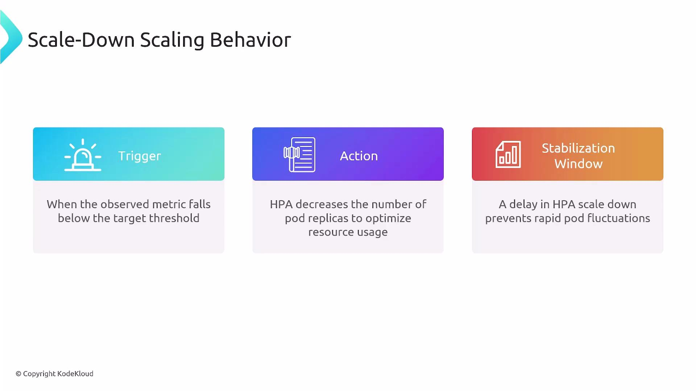
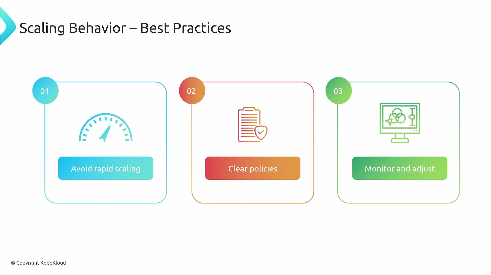

Welcome back. In this lesson we cover scaling behavior for the Horizontal Pod Autoscaler (HPA) in Kubernetes - how it decides when to add or remove pods, the policy knobs (ручки) you can tune, and best practices for stable autoscaling.

### Overview

- The Horizontal Pod Autoscaler (HPA) adjusts the replica count of Deployments and other scalable controllers to match observed load.
- Goals: keep application performance predictable while balancing resource usage and cost.
- HPA can scale using:
  - native resource metrics (CPU, memory),
  - custom in-cluster metrics,
  - external metrics (e.g., cloud provider or external systems).

### How scaling is triggered

HPA periodically evaluates the configured metrics (default every ~15 seconds). When an observed metric diverges (расходится, отклоняется) from the configured target (for example, average CPU utilization rises above (превышает) the target), the controller computes a target replica count and then applies scaling decisions subject (применяет решение о масштабировании) to configured limits and policies.

### Key stages in a scaling decision:

1. Observe metrics across the target pods.
2. Calculate desired replicas based on metric type and target.
3. Apply `minReplicas`/`maxReplicas` bounds (границы).
4. Respect `behavior` policies (stabilization windows and rate limits).
5. Execute the scale event (create or terminate pods).

### Important policy knobs you configure

| Policy knob | Purpose | Example / Notes |
| ----------- | ------- | --------------- |
| `minReplicas`, `maxReplicas` | Hard bounds for autoscaling | Enforce capacity limits to protect costs or guarantee minimum availability |
| `metrics` | Which metric(s) HPA uses to compute desired replicas | Types: `Resource` (CPU/memory), `Object`/`Pods`/`External` |
| `target` types | How targets are expressed | `Utilization`, `AverageValue`, `Value` |
| `behavior.scaleUp` / `behavior.scaleDown` | Rate-limiting and stabilization for up/down scaling | Define `stabilizationWindowSeconds` and `policies` (Percent / Pods) |

### Behavior policy types (examples)

| Policy type | Meaning |
| ----------- | ------- |
| Percent | Limit change by percentage of current replicas (e.g., 50%) |
| Pods | Limit change by absolute number of pods (e.g., 3 pods) |
| `stabilizationWindowSeconds` | Time window during which HPA will prefer previous higher or lower values to avoid flapping |

### Stabilization window and conservative scale-down

A stabilization window introduces a delay in evaluating the candidate (кандидат, требуемого) replica count, which smooths out (сгладить) transient (временные) metric spikes or drops and prevents oscillation (rapid scale-up then immediate scale-down). Typical defaults used by many clusters:

| Direction | Typical default | Effect |
| --------- | --------------- | ------ |
| scaleUp | 0 seconds | Enables fast reaction to rising load |
| scaleDown | 300 seconds (5 minutes) | Requires sustained low utilization before reducing replicas |

- sustained - длительный, устойчивый

This means HPA will usually scale up quickly to handle load, but it will wait (by default ~5 minutes) of sustained low utilization before scaling down - a conservative approach that reduces oscillations in noisy environments.

<br>

#### Example HPA manifest with behavior settings

Below is a practical HPA manifest that demonstrates common behavior settings. It targets a Deployment, defines min/max replicas, and configures both `scaleUp` and `scaleDown` policies to constrain how fast replicas can change.

```yaml
apiVersion: autoscaling/v2
kind: HorizontalPodAutoscaler
metadata:
  name: my-app-hpa
spec:
  scaleTargetRef:
    apiVersion: apps/v1
    kind: Deployment
    name: my-app-deployment
  minReplicas: 1
  maxReplicas: 10
  metrics:
    - type: Resource
      resource:
        name: cpu
        target:
          type: Utilization
          averageUtilization: 50
  behavior:
    scaleUp:
      stabilizationWindowSeconds: 0
      policies:
        - type: Percent
          value: 100
          periodSeconds: 60
    scaleDown:
      stabilizationWindowSeconds: 300
      policies:
        - type: Percent
          value: 10
          periodSeconds: 60
```

#### Notes about the example

- `averageUtilization: 50` tells HPA to target roughly (грубо, приблизительно) 50% CPU utilization per pod.
- `scaleUp`:
  - `stabilizationWindowSeconds: 0` means no delay for scale-up actions - HPA may respond immediately to rising load.
  - The `Percent` policy with `value: 100` allows doubling the replica count every `periodSeconds: 60`, bounded by `maxReplicas`.
- `scaleDown`:
  - `stabilizationWindowSeconds: 300` means HPA will observe low utilization for 5 minutes before acting.
  - The `Percent` policy with `value: 10` limits downscaling to at most 10% of current replicas per 60-second period.
- Policies are limits (caps), not guarantees (политики - это ограничения (предельные значения), а не гарантии): the HPA only changes replicas as much as needed, up to the specified limits.

Defaults and behavior can vary by Kubernetes version and cloud controller implementations. As a rule of thumb (как правило), prefer aggressive scale-up (short stabilization window) and conservative scale-down (longer stabilization window) to reduce oscillation.

### Best practices

- Align stabilization windows and rate limits with observed traffic patterns:
  - Short windows for bursty, latency-sensitive workloads.
  - Longer windows for noisy or highly variable workloads.
- Use meaningful metrics:
  - Resource metrics (CPU/memory) are easy to start with.
  - Add application-level metrics (latency, error rate, request queue length) for user-facing (значимых для пользователей) performance signals.
- Start conservative, observe, and iterate:
  - Monitor HPA events and scaling actions (`kubectl describe hpa <name>`).
  - Tune `policies` and `stabilizationWindowSeconds` gradually (постепенно) based on metrics.
- Avoid overly aggressive downscaling that removes capacity needed for short spikes.
- Combine HPA with Cluster Autoscaler (if using autoscaling nodes) to ensure node capacity scales with pod demand.

<br>

Be aware of control-plane and metrics-server differences across Kubernetes versions. Some behavior fields and defaults changed between `autoscaling/v2beta2` and `autoscaling/v2`. Always consult your cluster's API documentation before applying HPA manifests.