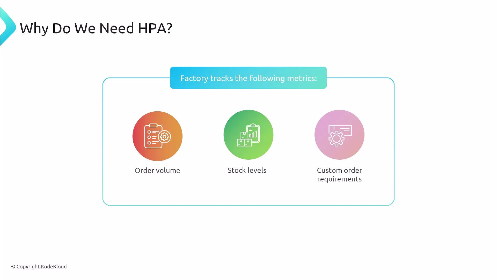
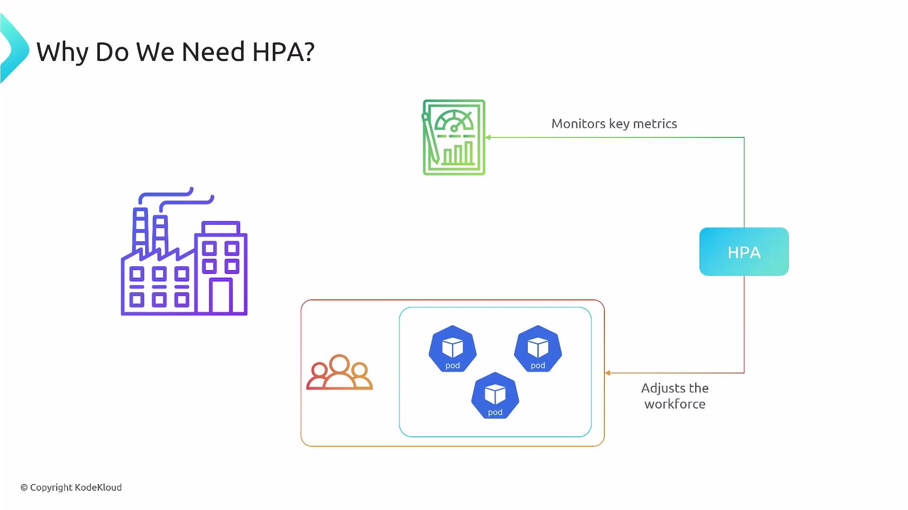
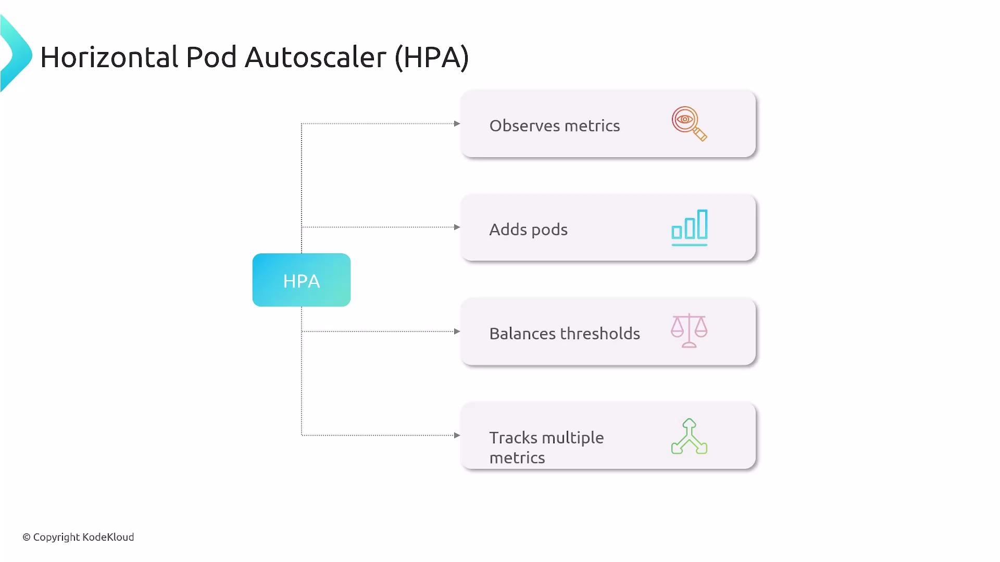

Welcome. In this lesson we explain the Kubernetes Horizontal Pod Autoscaler (HPA), why it matters, and how it works in practice.

At a high level, the HPA automatically adjusts the number of pod replicas for a workload (for example, a Deployment, ReplicaSet, StatefulSet, or any controller that supports the `scale` subresource) based on observed (наблюдаемых) metrics. To make this concrete (конкретным, наглядным), consider a factory analogy.

Imagine a factory with a steady (стабильная) team handling predictable (предсказуемым), day-to-day (повседневным) production. When demand is steady, the current workforce (рабочая сила) is sufficient. But during a sudden surge (всплеск) - seasonal demand or a flash sale - the existing team can't keep up (не поспевает, не справляется). The factory tracks metrics such as order volume, stock levels (уровень запасов), and custom order requirements (требования к индивидуальным заказам). When metrics indicate extra capacity (мощности) is needed, the factory brings in more workers; when demand falls, it scales down (сокращается) more conservatively (консервативно, осмотрительно) to avoid thrashing (колебаний).

This is exactly what the Horizontal Pod Autoscaler does for applications: it monitors relevant (соответствующие) metrics and adjusts pod replicas up or down to meet demand.

<br>

### How HPA works (overview)

- HPA periodically queries metrics via Kubernetes metrics APIs (resource, custom, and external metrics) and any configured metrics providers or adapters.
- For each configured metric it computes a desired replica count. When multiple metrics are used, HPA uses the largest desired replica value to satisfy the most constrained (ограниченной, строгой) metric.
- HPA enforces `minReplicas` and `maxReplicas` boundaries on the target workload.
- HPA supports:
  - Resource metrics (CPU, memory via Metrics Server or another provider)
  - Custom pod metrics (application-level metrics via adapters)
  - External metrics (from external systems)

<br>

### Conceptual scaling algorithm (алгоритм концептуального масштабирования)

1. HPA reads the current value of each configured metric and compares it to the metric target.
2. For each metric, it computes a desired replica count (for example, proportionally (пропорционально) scaling (масштабируя) based on current vs target values).
3. If multiple metrics are present, HPA chooses the maximum desired count produced by those metrics.
4. It updates the workload's replica count while respecting (учитывая при этом) `minReplicas`, `maxReplicas`, stabilization windows, and scaling policies to avoid rapid (резких) fluctuations (колебаний).

Practical tips:

HPA requires access to metric APIs. For built-in resource metrics like CPU and memory, install a Metrics Server (or another compatible provider) in the cluster. For custom or external metrics, configure the corresponding metrics adapter/provider.

### Metric types - quick reference

| Metric type | Kubernetes API | Use case | Example |
| ----------- | -------------- | -------- | ------- |
| Resource metrics | `metrics.k8s.io` (via Metrics Server) | Container CPU and memory utilization | `resource: { name: cpu, target: { type: Utilization, averageUtilization: 50 } }` |
| Custom pod metrics | Custom Metrics API | App-level metrics per pod (e.g., requests/sec) | `requests_per_second` reported by an adapter |
| External metrics | External Metrics API | Metrics external to cluster (e.g., queue length) | Queue depth from a message broker |

### Example: autoscaling/v2 HPA manifest

Below is a minimal `HorizontalPodAutoscaler` manifest (API `autoscaling/v2`) that targets CPU utilization and constrains replicas between 2 and 10:

```yaml
apiVersion: autoscaling/v2
kind: HorizontalPodAutoscaler
metadata:
  name: example-hpa
spec:
  scaleTargetRef:
    apiVersion: apps/v1
    kind: Deployment
    name: my-app
  minReplicas: 2
  maxReplicas: 10
  metrics:
    - type: Resource
      resource:
        name: cpu
        target:
          type: Utilization
          averageUtilization: 50
  behavior:
    scaleDown:
      stabilizationWindowSeconds: 300
      policies:
        - type: Percent
          value: 10
          periodSeconds: 60
```

Notes on the example:

- `behavior` provides rate-limiting and stabilization controls to avoid rapid scale-in/scale-out cycles.
- Use `autoscaling/v2` when you need multi-metric support and advanced behavior configuration.

HPA responsiveness (отзывчивость, скорость реакции) depends on metric availability and scraping frequency. Ensure your metrics provider is properly configured, and be cautious (будьте осторожны) when exposing custom metrics - misconfiguration can lead to unexpected scaling or resource exhaustion (исчерпанию).

<br>

### Summary

- The Horizontal Pod Autoscaler dynamically scales pod replicas to meet metric-driven targets (CPU, memory, custom, external).
- HPA collects metrics, computes desired replicas per metric, uses the highest desired value, and then updates replicas within configured min/max boundaries.
- For production use, combine proper metrics collection, sensible `minReplicas`/`maxReplicas`, and `behavior` policies for stability.