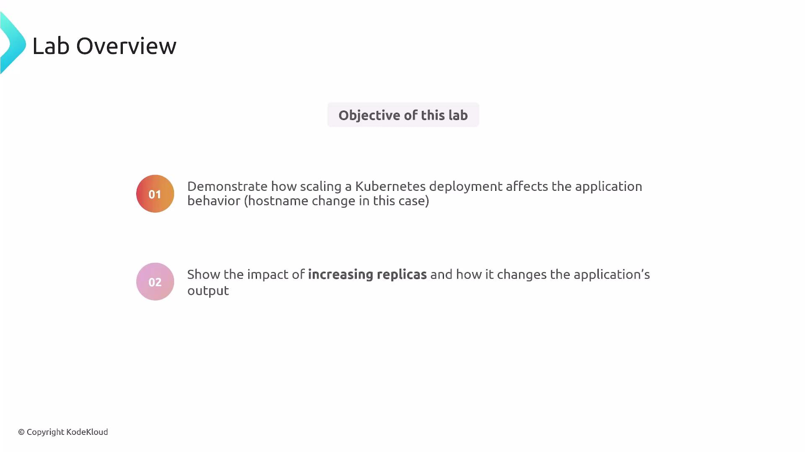
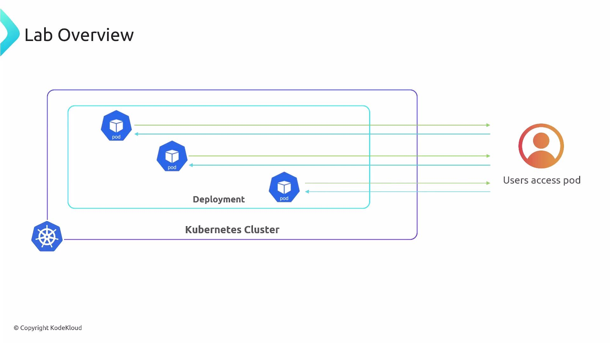
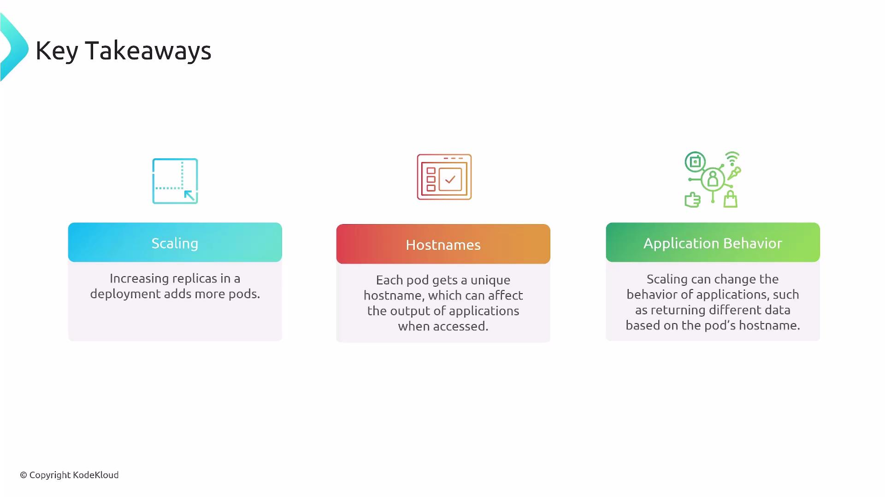

In this lesson we cover (рассмотрим) a manual Horizontal Pod Autoscaler (HPA) lab: how manually scaling a Deployment changes application behavior and what effects replica adjustments have on running pods and clients.

This lab demonstrates the manual side of horizontal pod autoscaling: you will scale a Deployment's replicas by hand, observe the pods that appear or disappear in the cluster, and note how pod hostnames (and therefore any application behavior that depends on the hostname) can change.

<br>

### Overview and objective (цель)

Goals:

- Manually scale a Deployment (increase and decrease replicas).
- Observe pods being created or removed and examine their unique names.
- Demonstrate how application output can change when pod hostnames change, and why that is generally (как правило) undesirable (нежелательно) for stateful interactions (взаимодействий).

Example scenario: scale a simple Flask web application up to three replicas.

### Manual scaling: commands and verification

Use `kubectl scale` to adjust the replica count on a Deployment:

```bash
$ kubectl scale deployment flask-web-app --replicas=3
```

Then verify pods and their status:

```bash
$ kubectl get pods
```

Example output:

```bash
NAME                               READY   STATUS    RESTARTS   AGE
flask-web-app-59d5f5df85-4pvbq     1/1     Running   0          2m12s
flask-web-app-59d5f5df85-f4ktj     1/1     Running   0          111s
flask-web-app-59d5f5df85-sc6jq     1/1     Running   0          2m12s
```

Commands summary:

| Command | Purpose |
| ------- | ------- |
| `kubectl scale deployment <name> --replicas=<N>` | Set desired replica count for a Deployment |
| `kubectl get pods` | List pods and their current state |
| `kubectl describe deployment <name>` | View Deployment details and ReplicaSet behavior |

Think of a Deployment as a neighborhood plan (план микрорайона) and pods as houses. When you scale the Deployment, Kubernetes (via the ReplicaSet managed by the Deployment) starts or stops pods to reach the requested replica count. Each pod receives a unique name (and, by default, the pod's hostname is set to its pod name). That means a hostname for a particular instance can change whenever (всякий раз когда) pods are recreated.

<br>

### Why pod hostnames matter

- Pod hostnames are tied to (привязаны к) pod names by default. When a pod is recreated, its name and hostname change.
- If your application returns or depends on hostname-specific data, client-visible (видимое для клиента) behavior may change after scaling or redeploys (for example, different responses or session binding (привязка сессии) to a pod hostname).
- Cloud-native best practices: design stateless pods and rely on stable endpoints (Services) rather than individual pod hostnames.

#### When to use Service vs StatefulSet

| Requirement | Recommended Kubernetes primitive |
| ----------- | -------------------------------- |
| Stable network identity (DNS) and load-balanced access | Service (ClusterIP / ExternalName / LoadBalancer) |
| Stable, persistent network identity per pod and attached storage | StatefulSet |

### Key takeaways

- Changing a Deployment's replica count is how (позволяет) you increase or decrease the number of running pod instances for an application.
- Every pod has a unique, ephemeral (эфемерный, недолговечный) hostname (derived (полученное) from the pod name by default); these hostnames can change when pods are recreated.
- Because of hostname ephemerality (эфемерность), do not rely on pod hostnames for durable (постоянной, долговременной) identity or sticky client behavior. Use Services for stable access, externalize (выносите состояние в БД, объектные хранилища) state (databases, object storage), or use StatefulSets when you specifically need stable pod identities and persistent volumes.

<br>

Prefer Services for stable access to an application, and prefer stateless pods for easy horizontal scaling. Use StatefulSets only when you require stable pod identities or persistent storage tied to individual pods.

Important: Do not use pod hostnames for durable session affinity (привязка сессии/сеанса), unique user identity (идентификации уникальных пользователей), or persistent storage binding. Those requirements need Services, external storage, or StatefulSets to ensure stability across scaling and restarts.

Understanding these behaviors is essential before introducing automated scaling (HPA), because an HPA changes replica counts dynamically based on metrics - the same considerations (соображения) about ephemeral hostnames and stateful behavior still apply.