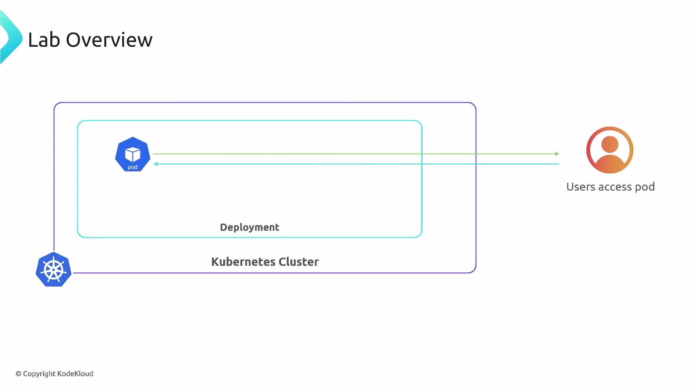

In this lesson we'll work through a hands-on lab for the [Vertical Pod Autoscaler (VPA)](https://learn.kodekloud.com/user/courses/kubernetes-autoscaling). The goal is to deploy a simple Flask application as a single-replica Deployment and observe how VPA (or a manual update) adjusts Pod resource requests. When resource requests change, Kubernetes replaces the existing Pod with a new Pod that reflects the updated resource settings.

Environment overview:

- A Kubernetes cluster runs a Deployment that manages a single Pod for the Flask application.
- Users access the application from outside the cluster.

<br>

Getting started

1. Apply the Deployment manifest to create (or update) the Flask application:

```bash
$ kubectl apply -f deployment.yml
```

2. Typical kubectl output after applying a manifest:

```bash
deployment.apps/flask-web-app configured
service/flask-web-app-service unchanged
```

3. Inspect Pods to observe how Kubernetes replaces Pods when resource requests change:

```bash
$ kubectl get pods
```

Example output you may see:

```bash
NAME                                   READY   STATUS        RESTARTS   AGE
flask-web-app-5d9dbb9d44-spjmk         1/1     Running       0          65s
flask-web-app-78689f449c-kq8xs         1/1     Terminating   0          3m13s
```

Why Pods are recreated

- Kubernetes treats (рассматривает, трактует) resource requests (CPU/memory) as immutable for a running Pod. To change those values, the Pod must be terminated and a new Pod created with the updated requests.
- VPA can observe resource usage and either propose (предлагать) new requests or automatically apply them. When VPA applies a change, the Pod is evicted and re-scheduled with the new resource requests.

VPA observes resource usage and can propose or apply new resource requests for Pods. When requests change, Pods are typically recreated (evicted and re-scheduled) so the new resource requests take effect.

Quick summary of the lab

- Deploy a single-replica Flask application using a Deployment.
- Apply an updated Deployment (or accept a VPA recommendation) that increases the Pod's resource requests.
- Kubernetes terminates the old Pod and brings up a new Pod with the larger resource allocation.
- This illustrates how Vertical Pod Autoscaler helps automate Pod resizing and simplifies resource management.

Steps & expected behavior

| Step | Action | Expected result |
| ---- | ------ | --------------- |
| 1 | `kubectl apply -f deployment.yml` | Deployment and Service are created/updated (see `kubectl` output above) |
| 2 | `kubectl get pods` | A new Pod enters `Running` while the old Pod moves to `Terminating` if requests changed |
| 3 | Observe resource requests | New Pod shows the updated CPU/memory requests in `kubectl describe pod <pod-name>` |

Useful commands

- Check Deployment status:

  ```bash
  $ kubectl get deployment flask-web-app
  ```

- Describe the new Pod to verify requests:

  ```bash
  $ kubectl describe pod <new-pod-name>
  ```

- View VPA recommendations (if VPA is installed):

  ```bash
  $ kubectl get vpa -o yaml
  ```