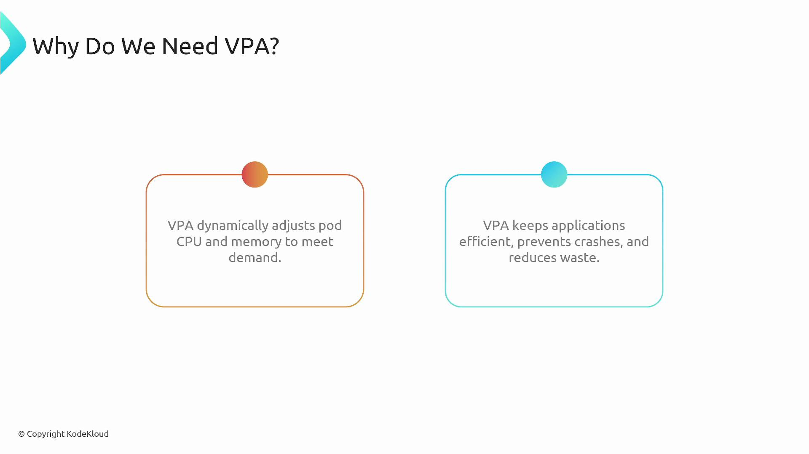
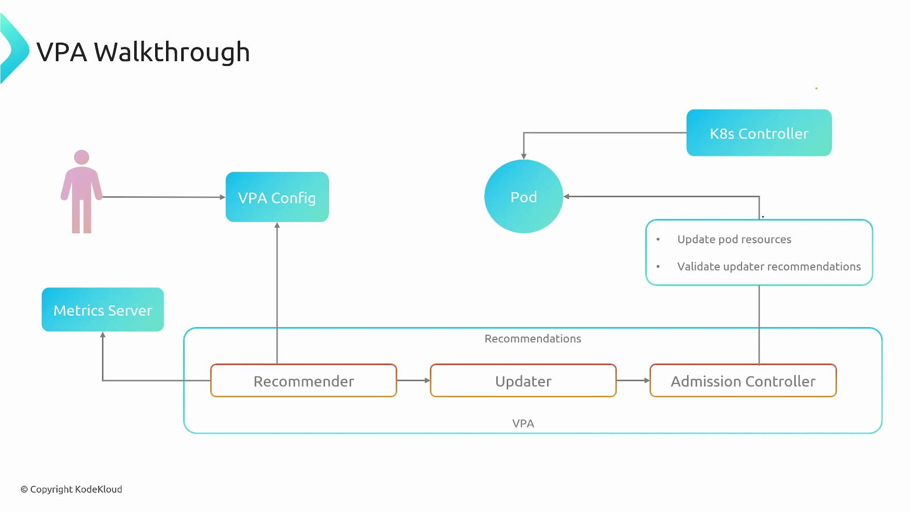

Welcome. This article explains the Vertical Pod Autoscaler (VPA) architecture: what VPA does, how its components interact, and how it complements (дополняет) horizontal autoscaling.

VPA helps right-size (подбирать размер) individual pods by adjusting their CPU and memory resource requests (and optionally limits) based on observed workload. Horizontal scaling (adding more replicas) and vertical scaling (increasing a pod's resources) solve different problems: VPA prevents poor performance or OOMs caused by under-provisioning and reduces waste (напрасные траты) from oversized requests by continuously recommending or applying better resource requests.

Think of VPA as an operations manager (операционный менеджер) that observes real workload patterns and adjusts each pod's "role size" (resource requests). VPA does not change a running container in-place (на лету) - it updates PodSpecs and triggers a pod restart (eviction + recreation) so the new pod starts with the adjusted request values.

 

### Why use VPA?

- Prevents performance degradation and OOM kills by ensuring pods get sufficient CPU and memory.
- Reduces wasted costs (напрасные расходы) from over-provisioned pods by recommending smaller, accurate (точные) resource requests.
- Complements (дополняет) Horizontal Pod Autoscaler (HPA): use HPA to scale the number of replicas; use VPA to right-size each replica.

### VPA core components

VPA is implemented as a control loop (контур управления) with three cooperating (взаимодействующих) components. The following table summarizes each component and its responsibilities.

| Component | Responsibility | Inputs |
| --------- | -------------- | ------ |
| Recommender | Observes pod CPU and memory usage over time and computes recommended resource requests (and optionally limits). | Metrics APIs (e.g., `metrics-server`), historical usage, OOM events, VPA configuration (target, min/max) |
| Updater | Compares current pod requests to recommendations and evicts pods when it's safe to apply updated requests. | Recommender suggestions (предложения), pod lifecycle/eviction safety checks (проверки безопасности) |
| Admission Controller (mutating webhook) | Injects recommended requests into a PodSpec at creation time so new pods start with the desired requests. | Admission requests for pod creation, Recommender targets |

- **Recommender**: Uses metrics sources and configured bounds to compute suggested CPU/memory requests. It analyzes historical patterns and OOM signals to produce conservative and safe recommendations.
- **Updater**: Orders and performs evictions only when it determines it is safe, coordinating with higher-level controllers to avoid destabilizing workloads.
- **Admission Controller**: Ensures replacement pods (or new pods) are created with the recommended requests by mutating the PodSpec at admission (вход, впуск) time.

### Modes of operation

VPA supports three modes that control how recommendations are applied:

| Mode | Behavior | Use case |
| ---- | -------- | -------- |
| `initial` | Sets resource requests when pods are created but does not evict running pods to apply updates. | Provide better defaults for new pods without disrupting (разрушения) running workloads. |
| `auto` | Actively enforces recommendations across the pod lifecycle: mutates new pods at creation and evicts/recreates pods when updated requests are necessary. | Continuous right-sizing in environments where restarts/evictions are acceptable. |
| `off` | Only records and exposes recommendations; does not mutate PodSpecs or evict pods. | Dry-run or analysis mode to observe suggested resource changes without applying them. |

Choose the mode that aligns with your deployment patterns and availability constraints. Note that changes to requests can affect how HPA calculates utilization (HPA commonly uses CPU requests as the denominator (знаменатель, делитель)), so plan and test accordingly.

VPA changes resource *requests* (and optionally limits) by causing pod restarts (evictions and recreations). Using VPA in `auto` mode can interact with other controllers (for example, HPA) and affect deployment availability. Always test VPA behavior in a staging environment (среда подготовки к выпуску) before enabling it in production.

### VPA operation (эксплуатация) walkthrough (пошаговое руководство)

A typical lifecycle with VPA looks like this:

1. Create/configure a VPA object for a workload (Deployment, StatefulSet, or a set of pods).
2. Recommender reads current and historical usage metrics and the VPA configuration (targets and bounds), then generates recommended CPU and memory requests.
3. Updater compares recommendations to current pod requests. If an update is needed and eviction is safe, the Updater evicts the pod so a replacement can be created with updated requests.
4. When the controller (for example, the Deployment controller) creates the replacement pod, the VPA Admission Controller intercepts the pod creation and injects the Recommender's recommended requests into the PodSpec.
5. The kube-controller-manager and the relevant controllers create the new pod with the updated requests. The Recommender continues observing usage and the loop (цикл) repeats (повторяется) as the workload changes.

This flow is shown in the diagram below: user config => Recommender uses metrics => Updater triggers evictions => Admission Controller injects recommendations into new PodSpecs.

 

### Best practices and considerations

- Start in `off` or `initial` mode to gather recommendations and validate them before enabling `auto`.
- Monitor interactions with HPA: changing requests affects utilization calculations and may change scaling decisions.
- Use min/max bounds in your VPA configuration to prevent recommendations outside acceptable ranges.
- Test VPA in a staging cluster with representative (показательный, характерный) workloads, paying attention (уделяя особое внимание) to eviction frequency and rollout impacts.
- Ensure your metric source (for example, `metrics-server` or a metrics adapter) provides reliable CPU and memory usage data for accurate recommendations.

### Putting it all together

VPA provides continuous right-sizing of pod resource requests to match real workload needs. The Recommender, Updater, and Admission Controller form a control loop that observes usage, computes targets, and applies them by recreating pods with updated requests. Choose the appropriate VPA mode and test interactions with other autoscalers and controllers to ensure application availability and predictable scaling behavior.