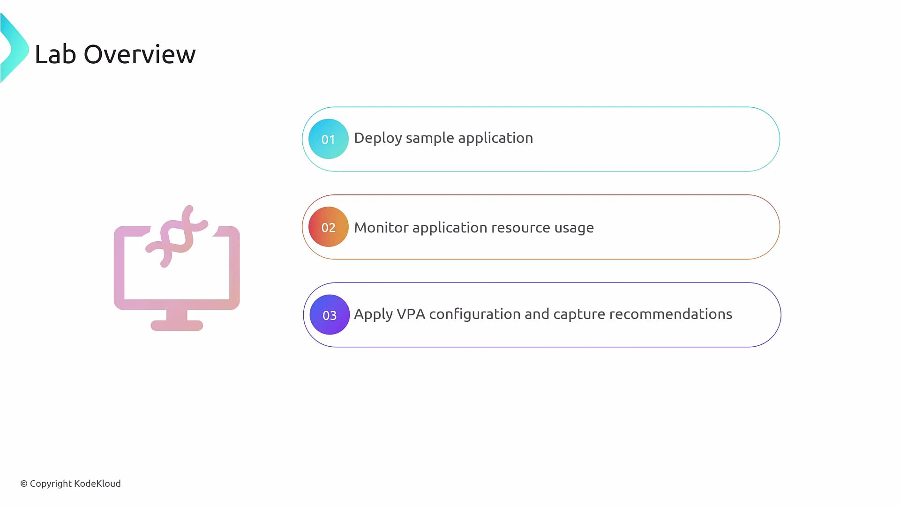

Welcome - this lab covers a CPU-focused Vertical Pod Autoscaler (VPA) workflow. The high-level flow mirrors the memory-focused lab but targets CPU:

- Deploy a sample application.
- Monitor CPU utilization.
- Apply a VPA that produces recommendations (no automatic updates).
- Run a CPU load test and validate VPA recommendations.

<br>

#### What you'll deploy

- A simple Flask application will act as the CPU workload for this lab.
- Initially the app is idle and uses very little CPU (typically ~1m).
- A VPA will be created to produce CPU recommendations only (no automatic updates). The VPA will enforce a minimum of `100m` and a maximum of `1000m` CPU for the container and will be configured to control CPU only.

#### VPA manifest `(vpa-cpu.yml`)

```yaml
apiVersion: autoscaling.k8s.io/v1
kind: VerticalPodAutoscaler
metadata:
  name: flask-app
spec:
  targetRef:
    apiVersion: apps/v1
    kind: Deployment
    name: flask-app-4
  updatePolicy:
    updateMode: "Off"  # Set to "Auto" for automatic updates
  resourcePolicy:
    containerPolicies:
      - containerName: '*'
        minAllowed:
          cpu: 100m
        maxAllowed:
          cpu: 1000m
        controlledResources: ["cpu"]
```

#### Quick explanation of the important fields

| Field | Purpose | Example / notes |
| ----- | ------- | --------------- |
| `targetRef` | Which Deployment the VPA should observe | `name: flask-app-4` |
| `updatePolicy.updateMode` | Whether the VPA should automatically change pod requests | `updateMode: "Off"` (recommendations only). Change to `"Auto"` to apply updates automatically. |
| `resourcePolicy.containerPolicies` | Per-container limits and controlled resources | `minAllowed: cpu: 100m`, `maxAllowed: cpu: 1000m`, `controlledResources: ["cpu"]` |

Apply the VPA:

```bash
$ kubectl apply -f vpa-cpu.yml

# Output:
verticalpodautoscaler.autoscaling.k8s.io/flask-app created
```

#### Inspecting recommendations

- With the app idle, the VPA typically recommends something near the configured minimum (100m) because current observed CPU usage is very low (≈1m).
- After generating CPU load against the Flask app, re-check the VPA recommendations. In this lab the recommendation rose (увеличилась, поднялась) from `100m` up to about `126m`, tracking (отслеживая, отражая) the increased observed CPU usage while respecting (уважая, соблюдая) the configured `minAllowed` and `maxAllowed` bounds.

#### Useful commands

- Check pod CPU usage:
  - `kubectl top pods`
- Check VPA status and recommendations:
  - `kubectl describe vpa flask-app`
  - `kubectl get vpa flask-app -o yaml`

Millicore reminder: 1 CPU = 1000m. So `100m` = 0.1 CPU and `126m` ≈ 0.126 CPU.

Caution when using `updateMode: "Auto"`: automatic updates may restart pods to change requests. Use Auto in production only after validating recommendations and testing rollout behavior.

#### Step-by-step walkthrough

1. Deploy the Flask test application (Deployment + Service).
2. Observe current CPU usage (e.g., `kubectl top pods`) - idle pods often show ~`1m`.
3. Create the VPA manifest (`vpa-cpu.yml`) and apply it:
   - `kubectl apply -f vpa-cpu.yml`
4. Inspect VPA recommendations while the app is idle:
   - `kubectl describe vpa flask-app`
   - Recommendations will typically be near the configured `minAllowed`.
5. Run a short CPU load test against the Flask service (tool of your choice).
6. Re-inspect the VPA recommendations and confirm they increased (e.g., from `100m` to ~`126m`), staying within `100m`-`1000m`.

#### Notes and tips

- The VPA only recommends values when `updateMode: "Off"`. To have the VPA apply changes automatically, set `updateMode` to `"Auto"`.
- VPA recommendations are based on observed usage over time - brief (кратковременные) spikes (всплески) may not immediately alter recommendations.
- Use `kubectl describe vpa <name>` to see summary recommendation information and any events.