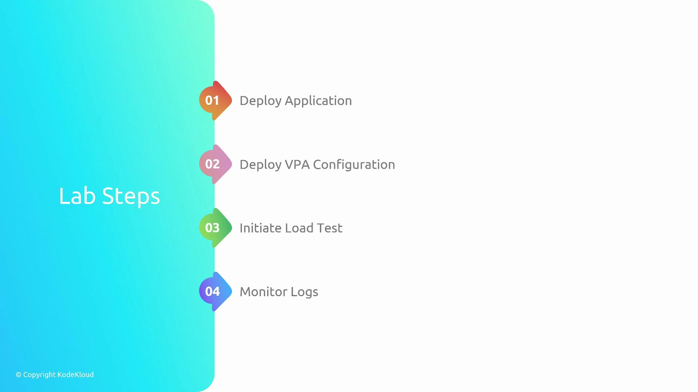
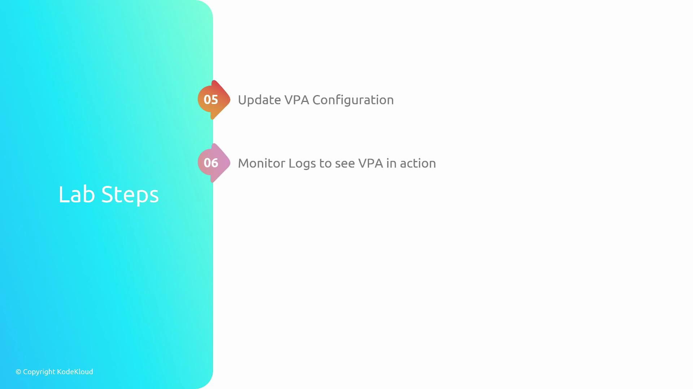

Welcome - this lesson runs a full Vertical Pod Autoscaler (VPA) lab so you can observe recommendations and automated updates in action. We'll deploy a sample Flask app, apply a VPA, generate load, and watch how the updater accepts recommendations and evicts pods to apply new resource requests.

#### High-level sequence:

- Deploy the sample Flask application (Deployment + Service).
- Apply a VPA with `updateMode: Off` to collect recommendations only.
- Generate load against the app so VPA can observe usage.
- Inspect the VPA updater logs while `Off` to confirm no evictions occur.
- Switch the VPA to `Auto` (or `Recreate`) to enable automatic application (применение).
- Watch the updater evict pods and confirm new pods run with updated requests.

<br>

#### Summary of the demo flow:

| Step | Command / Artifact | Purpose |
| ---- | ------------------ | ------- |
| 1 | `kubectl apply -f /root/vpa-cpu-app.yml` | Deploy Flask Deployment + Service so the app is reachable. |
| 2 | `kubectl apply -f /root/vpa-flask-app-vpa.yml` | Apply VPA with `updateMode: Off` to gather recommendations. |
| 3 | `sh load.sh` | Generate sustained (устойчивую) load so VPA can build resource observations (наблюдения за ресурсами). |
| 4 | `kubectl logs -f vpa-updater-<pod> -n kube-system` | Inspect updater behavior while updates are disabled. |
| 5 | `kubectl edit vpa flask-app` (change to `Auto`) or run `kubectl get vpa flask-app -o jsonpath='{.spec.updatePolicy.updateMode}'` | Enable automatic application of recommendations. |
| 6 | `kubectl get pods` | Confirm pods are recreated and new pods reflect VPA recommendations. |

For more on VPA concepts, see the Kubernetes docs: [Vertical Pod Autoscaler](https://github.com/kubernetes/autoscaler/tree/master/vertical-pod-autoscaler).

<br>

### 1) Deploy the sample app

Apply the manifest for the sample Flask application. The manifest creates both a Deployment and a Service so the app can be load-tested.

```bash
$ kubectl apply -f /root/vpa-cpu-app.yml
```

Expected output:

```console
deployment.apps/flask-app created
service/flask-app-service created
```

Confirm the Deployment and Service are created and pods are running before proceeding.

### 2) VPA configuration (initial)

Create a VPA that targets the `flask-app` Deployment. Start with `updateMode: Off` so the VPA only computes and exposes recommendations without evicting pods.

```yaml
apiVersion: "autoscaling.k8s.io/v1"
kind: VerticalPodAutoscaler
metadata:
  name: flask-app
spec:
  targetRef:
    apiVersion: "apps/v1"
    kind: Deployment
    name: flask-app
  updatePolicy:
    updateMode: "Off"
  resourcePolicy:
    containerPolicies:
    - containerName: '*'
      minAllowed:
        cpu: 100m
        memory: 100Mi
      maxAllowed:
        cpu: 800m
        memory: 500Mi
      controlledResources: ["cpu", "memory"]
```

This manifest:

- Targets the `flask-app` Deployment.
- Uses `updateMode: Off` so the updater will not evict pods (only recommendations are generated).
- Sets `minAllowed` and `maxAllowed` to constrain suggestions.
- Controls `cpu` and `memory` resources.

Apply the VPA manifest:

```bash
$ kubectl apply -f /root/vpa-flask-app-vpa.yml
```

Inspect VPA recommendations and bounds:

```bash
$ kubectl describe vpa flask-app
```

Sample (truncated) `kubectl describe vpa` output:

```yaml
Recommendation:
  Container Recommendations:
    Container Name: flask-app
    Lower Bound:
      Cpu: 100m
    Target:
      Cpu: 100m
    Uncapped Target:
      Cpu: 25m
    Upper Bound:
      Cpu: 800m
```

At this stage the updater provides recommendations but does not evict or modify pods.

### 3) Start a load test

Generate traffic so the VPA collects realistic resource usage metrics. For this lab the provided script is used:

```bash
$ sh load.sh
```

Sample console output (repeated responses):

```console
Hello, World!Hello, World!Hello, World!Hello, World!Hello, World!Hello, World!
```

Allow the load to run for several minutes so VPA accumulates (накапливать) observations and refines (уточнить, усовершенствовать) its recommendations.

### 4) Inspect the VPA updater logs (while updateMode is Off)

While `updateMode` remains `Off`, confirm the updater is collecting data but not evicting pods.

Identify the updater pod name (example shown below uses `vpa-updater-59469d986c-gw5jf` - replace with your pod name):

```bash
$ kubectl -n kube-system logs -f vpa-updater-59469d986c-gw5jf
```

Example logs showing the updater skipping VPA objects that aren't in an active update mode:

```console
I0104 12:28:33.901166        1 updater.go:150] skipping VPA object default/flask-app because its mode is not "Recreate" or "Auto"
W0104 12:28:33.901197        1 updater.go:166] no VPA objects to process
```

VPA behavior is split into two concerns (аспекта): (1) computing recommendations based on observed usage, and (2) applying those recommendations by evicting pods so new pods start with updated requests. `updateMode: Off` disables automatic application; use `Auto` or `Recreate` to enable eviction and automatic application.

### 5) Enable automatic updates

When you're ready for the VPA to apply recommendations, change `updateMode` to `Auto` (or `Recreate` if you require a different eviction behavior). Editing in-place:

```bash
$ kubectl edit vpa flask-app
```

Change the `updatePolicy` block to:

```yaml
updatePolicy:
  updateMode: "Auto"
```

Verify the change:

```bash
$ kubectl get vpa flask-app -o jsonpath='{.spec.updatePolicy.updateMode}'
```

Expected output:

```console
Auto
```

Enabling `Auto` (or `Recreate`) will allow the VPA updater to evict pods to apply recommended resource requests. Be prepared for transient pod restarts and possible brief disruptions (нарушения, сбои) to service. Use during maintenance windows if running in production.

### 6) Watch the updater apply recommendations

With `Auto` enabled and load in effect, the updater will accept recommendations, evict selected pods, and let the Deployment create new pods with the updated resource requests. Tail the updater logs again to observe this flow:

```bash
$ kubectl -n kube-system logs -f vpa-updater-59469d986c-gw5jf
```

Example log lines showing accepted recommendations and eviction events:

```console
I0104 12:39:33.906873       1 update_priority_calculator.go:146] pod accepted for update default/flask-app-67b666c5fc-k9rtg with priority 586 - processed recommendations:
flask-app: target: 587m; uncappedTarget: 587m;

I0104 12:39:33.906922       1 update_priority_calculator.go:146] pod accepted for update default/flask-app-67b666c5fc-fpw77 with priority 586 - processed recommendations:
flask-app: target: 587m; uncappedTarget: 587m;

I0104 12:39:33.906962       1 updater.go:228] evicting pod default/flask-app-67b666c5fc-k9rtg

I0104 12:39:33.919716       1 event.go:298] Event(v1.ObjectReference{Kind:"Pod", Namespace:"default", Name:"flask-app-67b666c5fc-k9rtg", UID:"ea3379ed-eeef-4b2e-b0b4-9ef30e3fe009", APIVersion:"v1", ResourceVersion:"4137", FieldPath:""}): type: 'Normal' reason: 'EvictedByVPA' Pod was evicted by VPA Updater to apply resource recommendation.
```

These lines show the updater computed a target CPU (~587m) and evicted pods so the Deployment could recreate them with the new resource requests.

### 7) Confirm new pods are running with updated resource requests

After evictions and recreations, list pods and verify ages and resource requests. New pods created after eviction will have a low AGE value:

```bash
$ kubectl get pods
```

Example output:

```console
NAME                          READY  STATUS   RESTARTS  AGE
flask-app-67b666c5fc-41b5s    1/1    Running   0        43s
flask-app-67b666c5fc-96jf9    1/1    Running   0        103s
```

To inspect the resource requests of a pod's containers, describe the pod or check the Deployment's pod template after the VPA has updated the requests:

```bash
$ kubectl describe pod flask-app-67b666c5fc-41b5s
# or
$ kubectl get deployment flask-app -o yaml
```

Look for the `resources.requests` fields to verify they reflect the VPA recommendations.

That completes the end-to-end demo. You can now practice applying VPA manifests, generating load, and watching the updater behavior.