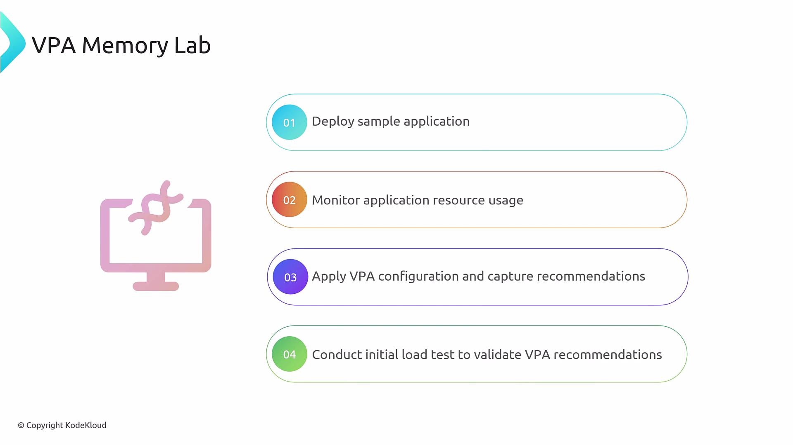

Welcome - in this lab you'll see the Vertical Pod Autoscaler (VPA) in action for tuning memory requests based on observed usage. This walkthrough (пошаговое руководство) covers deploying a sample (образец, демонстрационное приложение) Flask app, observing baseline (базовый уровень) memory, applying a memory-only VPA, and validating recommendations under load.

<br>

#### Overview - what you'll do

- Deploy a simple Flask application and a Kubernetes Service.
- Observe pods and current CPU/memory usage to establish (установить, определить) a baseline.
- Create a VPA object targeting the Flask Deployment to collect memory recommendations.
- Generate load and observe how VPA recommendations update.

#### Quick workflow

1. Deploy the sample application.
2. Monitor memory usage (baseline).
3. Apply the VPA manifest (memory-only policy).
4. Run a load test and re-check recommendations.

#### Prerequisites

- A Kubernetes cluster with `kubectl` configured for your context.
- metrics-server or other metrics provider installed to view pod resource usage (`kubectl top pods`).
- VPA components (CRD + controller: recommender, updater, admission-controller if needed) installed so the VerticalPodAutoscaler resource can produce recommendations.

#### Deploy and inspect the sample application

- After deploying the Flask app and Service, confirm pods are running:

  ```bash
  $ kubectl get pods
  ```

  Example output:

  ```text
  NAME                           READY   STATUS    RESTARTS   AGE
  flask-app-b85fc57d4-kmsdl      1/1     Running   0          101s
  flask-app-b85fc57d4-zn77q      1/1     Running   0          101s
  ```

- Check current memory usage (with metrics-server):

  ```bash
  $ kubectl top pods
  ```

  Note typical baseline memory consumption (example: ~19Mi) so you can compare before/after load.

#### VPA configuration used in this lab

This VPA manifest is configured to provide memory recommendations only. It sets `minAllowed` and `maxAllowed` memory bounds and uses `updateMode: Off` so changes are recommendations only (изменения носят лишь рекомендательный характер).

```yaml
---
apiVersion: "autoscaling.k8s.io/v1"
kind: VerticalPodAutoscaler
metadata:
  name: flask-app
spec:
  # recommenders field can be unset when using the default recommender.
  # When using an alternative recommender, specify it as a list:
  # recommenders:
  #  - name: 'alternative'
  targetRef:
    apiVersion: "apps/v1"
    kind: Deployment
    name: flask-app
  updatePolicy:
    updateMode: "Off"
  resourcePolicy:
    containerPolicies:
      - containerName: '*'
        minAllowed:
          memory: 150Mi
        maxAllowed:
          memory: 1000Mi
        controlledResources: ["memory"]
```

This VPA is restricted to memory recommendations (`controlledResources`). With `updateMode: "Off"`, VPA only reports recommendations - it will not modify pod resource requests automatically.

Apply the VPA manifest:

```bash
$ kubectl apply -f vpa-memory.yaml
```

Ensure the VPA CRD/controller are installed, otherwise the resource may be unrecognized or will not produce recommendations.

Example create output:

```text
verticalpodautoscaler.autoscaling.k8s.io/flask-app created
```

If the VPA controller or CRD is missing, `kubectl get vpa` may return "no resources found" or the resource may appear but never populate (не будет заполнено) `status.recommendation`. Install the VPA components from the official project before proceeding: https://github.com/kubernetes/autoscaler/tree/master/vertical-pod-autoscaler

#### Inspecting VPA recommendations (before load)

- Get the VPA object to view recommendations:

  ```bash
  $ kubectl get vpa flask-app -o yaml
  ```

- Immediately after creation (before load) you may see recommendations that reflect current usage and your configured bounds. Example snippet:

  ```yaml
  status:
    conditions:
    - lastTransitionTime: "2025-01-15T08:10:03Z"
      status: "True"
      type: RecommendationProvided
    recommendation:
      containerRecommendations:
      - containerName: flask-app
        lowerBound:
          memory: 262144k
        target:
          memory: 262144k
        uncappedTarget:
          memory: 262144k
        upperBound:
          memory: 1000Mi
  ```

#### Key recommendation fields (summary)

| Field | Meaning |
| ----- | ------- |
| `lowerBound` | Minimum recommended request for the container (respects `minAllowed`). |
| `target` | The recommended request balancing utilization and stability - the value you should consider applying. |
| `uncappedTarget` | The recommender's ideal recommendation ignoring `minAllowed` / `maxAllowed` bounds. |
| `upperBound` | Maximum recommended request for the container (reflects `maxAllowed`). |

- uncapped - без ограничений

#### Generating load and re-checking recommendations

- Run the provided load script to stress the Flask app:

  ```bash
  $ sh load.sh
  ```

  Example output:

  ```text
  Hello world!
  ```

- Let the load run long enough for the recommender to observe increased memory usage, then re-check VPA:

  ```bash
  $ kubectl get vpa flask-app -o yaml
  ```

  Example updated recommendation after load:

  ```yaml
  recommendation:
    containerRecommendations:
    - containerName: flask-app
      lowerBound:
        memory: 262144k
      target:
        memory: "511772K"
      uncappedTarget:
        memory: "511772K"
      upperBound:
        memory: 1000Mi
  ```

#### Interpreting recommendations after load

- `target` and `uncappedTarget` increase to match observed memory usage (example: ~512Mi).
- If `uncappedTarget` stays within `maxAllowed`, VPA's effective recommendation will equal the uncapped recommendation.
- If `uncappedTarget` exceeds `maxAllowed` (e.g., uncapped 1200Mi while `maxAllowed` = 1000Mi), VPA will cap (ограничит) the recommendation at `maxAllowed`. Decide whether to raise (поднимать, повышать) `maxAllowed` if your app legitimately (законно, действительно) needs more memory, or consider horizontal scaling (more replicas) instead of a single larger instance.

#### Practical considerations and best practices

- Use `updateMode: "Off"` in production if you require manual review before applying resource changes.
- Large memory allocations (выделение) can impact node packing (набивка, уплотнение) and garbage collection (сборка мусора) - review node capacity and application behavior before increasing memory limits.
- VPA is best for adjusting requests for workloads that benefit from vertical scaling (для нагрузок, которые выигрывают от вертикального масштабирования) (single-pod improvement). For horizontally scalable services, prefer Horizontal Pod Autoscaler (HPA) or combine VPA with HPA carefully.
- Always verify metrics collection (e.g., metrics-server) and VPA controller health to ensure accurate recommendations.

This finishes the conceptual walkthrough for the VPA Memory Lab. In the hands-on lab you will perform these steps and observe how recommendations change between baseline and under load.