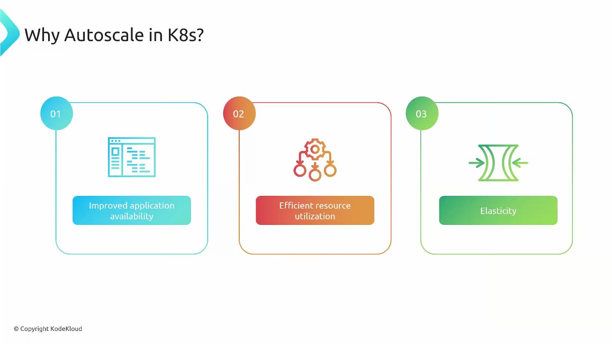

Welcome. In this lesson we explain why autoscaling is essential (необходимый) for modern cloud-native (облачно-ориентированных) applications and how Kubernetes implements autoscaling across different layers. If your application has ever experienced (сталкивалось) sudden traffic spikes (e.g., flash sales, product launches, or unexpected load), autoscaling can help maintain performance while controlling costs.

Key benefits of autoscaling:

- Cost savings: pay only for the capacity you need by scaling down idle resources.
- Improved availability: absorb (поглощать, впитывать, сглаживать) traffic spikes automatically to keep user experience consistent.
- Efficient resource utilization: avoid over-provisioning (избыточное) and under-provisioning (недостаточное); maintain (поддерживайте) a "Goldilocks" (златовласка, золотая середина, оптимальный) resource level.
- Elasticity (эластичность): automatically adjust resources up or down as demand changes.
- Fault tolerance and recovery: redistribute (перераспределение) and re-provision (повторное развертывание) workloads to tolerate failures and speed (ускорения) recovery.
- Simplified operations: reduce manual scaling and free teams to focus on higher-value work.

 

Autoscaling lets applications adapt to unpredictable traffic patterns with minimal human intervention: when demand rises, capacity grows; when demand falls, capacity shrinks (сокращается). That combination protects user experience and reduces cloud spend (расходы на облачные ресурсы) - a critical goal for production systems.

### How Autoscaling Maps to Kubernetes

Kubernetes autoscaling works at multiple layers. Understanding the distinction helps you choose the right tool for each problem.

Two primary scaling aspects in Kubernetes:

1. Cluster scaling - changes the number or size of worker nodes (virtual machines) in the cluster.
2. Pod (workload) scaling - changes the number of application replicas (pods) or adjusts pod resource requests/limits.

Cluster scaling offers OS-level resources (CPU, memory, disk, GPUs). Pod scaling adjusts application concurrency and throughput. Both layers complement one another: pod-level autoscalers create demand for node capacity, and cluster autoscalers provide that capacity.

<Frame>
  
</Frame>

## Cluster Scaling (Node-level autoscaling)

Cluster scaling changes the number of worker nodes available to schedule pods. The most common implementation is the Cluster Autoscaler, which reacts to unschedulable pods and node utilization patterns — adding nodes when pods can't be scheduled and removing nodes when they become unnecessary (only when pods can be safely moved).

<Callout icon="lightbulb" color="#1CB2FE">
  Note: The Cluster Autoscaler is different from the Cluster Proportional Autoscaler (CPA). CPA adjusts replica counts of cluster add-on controllers (for example, scaling add-on Deployments relative to cluster size), while the Cluster Autoscaler manages worker node counts. They solve different problems — don’t confuse them.
</Callout>

Cluster autoscaling increases the cluster’s total compute capacity (CPU, RAM, disk, GPUs), enabling pod-level autoscalers such as HPA or VPA to place new pods and meet resource requests.

<Frame>
  
</Frame>

Learn more:

* Cluster Autoscaler documentation: [https://github.com/kubernetes/autoscaler/tree/master/cluster-autoscaler](https://github.com/kubernetes/autoscaler/tree/master/cluster-autoscaler)
* Cloud provider-specific autoscalers: check your provider docs (GKE, EKS, AKS).

## Pod (Workload) Scaling

Pod scaling operates at the application level. The main approaches are:

* Horizontal Pod Autoscaler (HPA): scale the number of pod replicas based on metrics (CPU, memory, custom metrics).
* Vertical Pod Autoscaler (VPA): adjust CPU/memory requests for containers; VPA may evict and restart pods depending on its mode to apply new resource values.
* Event-driven scaling (KEDA): scale workloads in response to external events or queue lengths (e.g., Kafka, Azure Service Bus, RabbitMQ).

Stateful workloads (databases, clustered storage, etc.) need special care. Scaling them often involves additional steps (replication topology, data consistency, and operational procedures). Test and plan before applying autoscaling to stateful services.

<Frame>
  
</Frame>

## Why Use Different Strategies?

Cluster scaling and pod scaling address different problems:

* Cluster scaling ensures infrastructure capacity and availability (nodes).
* Pod scaling ensures application throughput and efficiency (replicas/resources).

Combining the right set of autoscalers (HPA, VPA, KEDA + Cluster Autoscaler) gives you a balanced system: responsive, cost-efficient, and resilient.

<Frame>
  
</Frame>

Below is a quick comparison to help decide which autoscaler to use:

| Concern | Use Cluster Autoscaler | Use Pod Autoscalers (HPA/VPA/KEDA) |
| - | - | - |
| Increase raw node capacity (CPU, memory, GPUs) | Yes | No |
| Scale application replicas to handle request volume | No | Yes (HPA/KEDA) |
| Adjust container resource requests for better bin-packing | No | Yes (VPA) |
| React to external event queues or brokers | No | Yes (KEDA) |
| Avoid pod scheduling failures due to insufficient nodes | Yes | Indirectly (pod autoscalers increase demand) |
| Best for stateful databases | Usually no (handle with care) | Typically limited — requires application-level changes |

## Summary

* Autoscaling reduces cost and operational overhead while improving availability and resilience.
* Cluster autoscaling adjusts the pool of nodes (infrastructure level).
* Pod autoscaling changes replicas or resource allocations (application level).
* Use HPA for replica scaling, VPA for resource-sizing, KEDA for event-driven scaling, and Cluster Autoscaler for node management.
* Exercise caution with stateful applications: design, test, and roll out autoscaling carefully.

Further reading and references:

* Kubernetes Basics: [https://kubernetes.io/docs/concepts/overview/what-is-kubernetes/](https://kubernetes.io/docs/concepts/overview/what-is-kubernetes/)
* Horizontal Pod Autoscaler: [https://kubernetes.io/docs/tasks/run-application/horizontal-pod-autoscale/](https://kubernetes.io/docs/tasks/run-application/horizontal-pod-autoscale/)
* Vertical Pod Autoscaler: [https://github.com/kubernetes/autoscaler/tree/master/vertical-pod-autoscaler](https://github.com/kubernetes/autoscaler/tree/master/vertical-pod-autoscaler)
* KEDA: [https://keda.sh/](https://keda.sh/)

This lesson introduced the "why" and "what" of autoscaling in Kubernetes. The course continues with practical configuration and operational examples for Cluster Autoscaler, HPA, VPA, and event-driven scalers.

<CardGroup>
  <Card title="Watch Video" icon="video" cta="Learn more" href="https://learn.kodekloud.com/user/courses/kubernetes-autoscaling/module/66710f67-c094-4a4c-b718-4a031d1ddebe/lesson/e57460fa-c121-4d31-b5a2-1d54caee9b49" />
</CardGroup>

This documentation is built and hosted on [Mintlify](https://mintlify.com), a developer documentation platform.